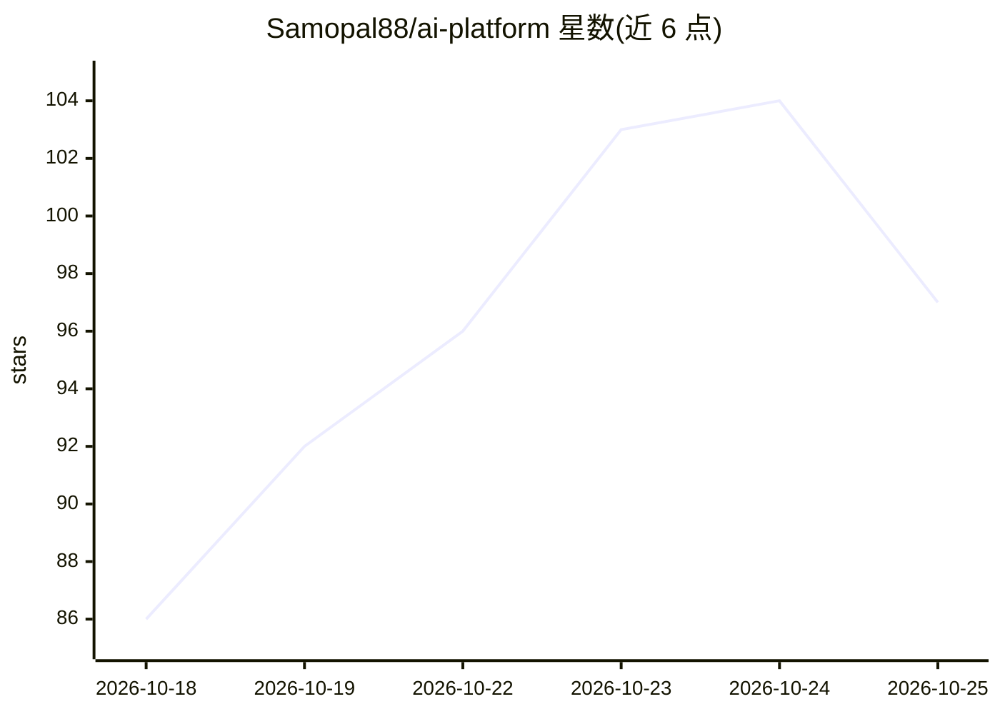

# Samopal88/ai-platform

⭐ 97 · Python · 推送 2026-09-21 · [GitHub](https://github.com/Samopal88/ai-platform) · 个人维护 · 中文 README

**自托管 AI 工作台：多模型聊天、文件与项目记忆一体化**

基于 FastAPI 的单应用自托管 AI 工作区：提供项目、持久聊天、文件上传、项目记忆、摘要与索引、上下文组装，以及图像生成、语音转文字和网页搜索界面。支持 OpenAI 兼容、Anthropic、RouterAI、RuAPI、ClaudeHub、Google/Gemini 等多条模型路由，带模型目录与套餐/层级访问控制、用量统计、操作员仪表盘与自主任务执行器。默认 SQLite 本地即用，生产需 PostgreSQL 与外部凭据。跨平台安装向导与 Linux systemd 用户服务安装。

## 筛选速览

| 维度 | 判定 | 备注 |
|---|---|---|
| AI 角色 | `ai-native` | 本体是模型或模型工具 |
| 许可风险 | `none` | — |
| 部署形态 | `desktop` | 安装包/桌面程序 |
| 模型依赖 | — | README 未给出锁定关系 |
| 硬件要求 | — | 无带数字的原话,不猜 |
| 安装摩擦 | `low` | 无编译、无系统依赖或容器化 |
| 成熟度 | `idea` | |

## 能力要点

- 多 provider 模型路由（OpenAI 兼容/Anthropic/RouterAI/RuAPI/ClaudeHub/Gemini）
- 项目记忆、摘要、索引与上下文组装
- 图像生成、语音转文字与网页搜索界面
- 操作员仪表盘与自主任务执行器，可选 YooKassa/SMTP 集成

## 适用场景

- 自建一个多模型的团队 AI 聊天与文件工作区
- 按套餐/层级管理不同用户的模型访问与用量
- 在 Linux 上以 systemd 用户服务长期运行 AI 工作台

## 场景标签

`聊天机器人` `图像生成` `语音识别` · 领域:对话与助手

## 证据(README 行号)

> L5: Self-hosted AI workspace with projects, chats, files, memory, multiple model
> L17: - AI chat with OpenAI-compatible, Anthropic, RouterAI, RuAPI and ClaudeHub routes;
> L20: - file-edit previews, image generation, speech-to-text and web-search surfaces;

## 星数曲线

2026-10-18 86 → 2026-10-25 97（+11）

---
*卡片 v1 · prompt 1.4 · 生成 2026-10-23 · 置信度 mid · 依据 README sha `0c4bb67f84e1` · [字段定义](../../DATASET.md)*
