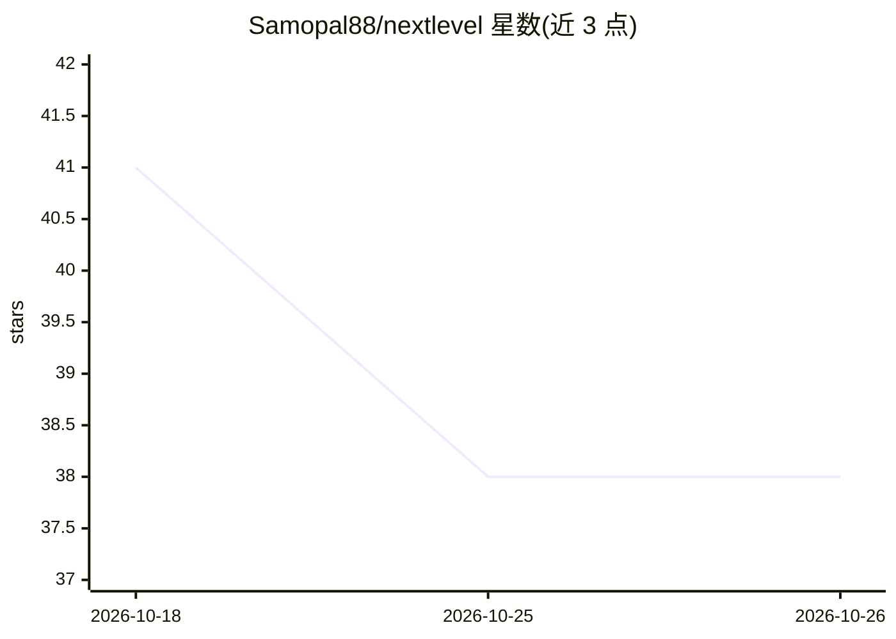

# Samopal88/nextlevel

⭐ 38 · Python · 推送 2026-09-20 · [GitHub](https://github.com/Samopal88/nextlevel) · [官网](https://t.me/nextlvlgm) · 个人维护

**自托管的 Telegram 游戏动漫 RSS 自动发布器，可选 LLM 改写**

单体 Python 服务：定时抓取内置的 7 个游戏与动漫 RSS 源，按 URL 去重与时效过滤后构建带图帖子，按时区感知的排期发布到 Telegram 频道。可选接入任意 OpenAI 兼容的 /chat/completions 端点生成俄语摘要，LLM 不可用时回退本地确定性格式化。状态以 JSON 原子写入实现去重持久化，支持 Docker、Railway、pipx 安装与 dry-run 预览。面向希望建立新闻频道的 Telegram 频道运营者。

## 筛选速览

| 维度 | 判定 | 备注 |
|---|---|---|
| AI 角色 | `ai-enhanced` | 去掉 AI 部分产品仍成立 |
| 许可风险 | `none` | — |
| 部署形态 | `self-host` | docker 或自建部署 |
| 模型依赖 | — | README 未给出锁定关系 |
| 硬件要求 | — | 无带数字的原话,不猜 |
| 安装摩擦 | `low` | 无编译、无系统依赖或容器化 |
| 成熟度 | — | 结构信号不足 |

## 能力要点

- 7 个内置游戏/动漫 RSS 源，支持时区感知多时段排期发布
- URL 去重、时效过滤与图片发现（RSS media/内嵌内容/Open Graph）
- 可选 OpenAI 兼容端点做俄语改写，失败回退本地格式化
- pipx/Docker/Railway 部署，--dry-run 无需凭据预览

## 适用场景

- 自动把游戏动漫新闻源定时发到我的 Telegram 频道
- 用 LLM 生成摘要式帖子而非转发原文
- 通过 Docker 或 Railway 长期托管运行

## 场景标签

`网页抓取` `工作流自动化` `AI 写作` · 领域:效率与自动化

## 证据(README 行号)

> L7: **Next Level** is a small, self-hosted Telegram autopublisher for gaming and anime news. It collects recent RSS entr
> L22: - Optional Russian-language rewriting through any OpenAI-compatible `/chat/completions` endpoint.
> L33: Without an LLM, the bot uses a deterministic local formatter and preserves the feed excerpt. With an LLM configured

## 星数曲线

2026-10-18 41 → 2026-10-26 38（-3）

---
*卡片 v1 · prompt 1.4 · 生成 2026-10-25 · 置信度 high · 依据 README sha `0d175155ec76` · [字段定义](../../DATASET.md)*
