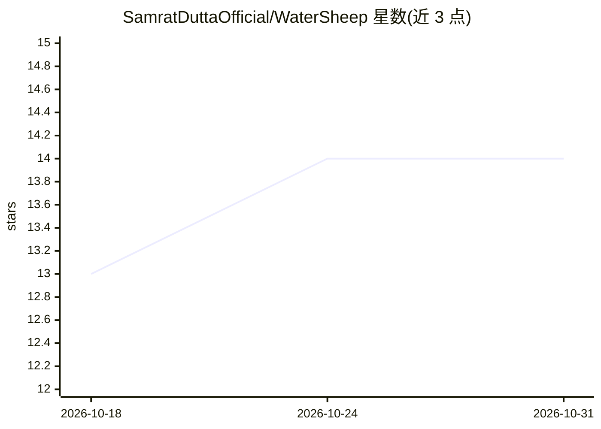

# SamratDuttaOfficial/WaterSheep

⭐ 14 · Python · Apache-2.0 · 推送 2026-10-25 · [GitHub](https://github.com/SamratDuttaOfficial/WaterSheep) · [官网](https://samratduttaofficial.github.io/WaterSheep/) · 个人维护

**文本决策模型：对任意文本输出带概率的校准判定**

基于 ModernBERT-base 微调（加决策头）的分类模型，针对任意英文文本回答四类问题：yes/no、单选、评分量表与多标签，每个选项均输出概率，并按问题类型做温度校准（报告 ECE）。提供 transformers pipeline、Python 包、本地 HTTP 服务器（兼容 Jev 的 API，供 TypeSafe SDK 无改动调用）、浏览器端 JS（ONNX 量化模型）与 Hugging Face Inference Endpoint 多种使用方式。限制：仅英文、长输入被截断、评分量表准确率较低、不单独用于高风险决策。

## 筛选速览

| 维度 | 判定 | 备注 |
|---|---|---|
| AI 角色 | `ai-native` | 本体是模型或模型工具 |
| 许可风险 | `permissive` | Apache-2.0 |
| 部署形态 | `library` | 以包/库形式分发 |
| 模型依赖 | — | README 未给出锁定关系 |
| 硬件要求 | — | 无带数字的原话,不猜 |
| 安装摩擦 | `low` | 无编译、无系统依赖或容器化 |
| 成熟度 | — | 结构信号不足 |

## 能力要点

- 支持 yes/no、单选、评分、多标签四类问题并输出每选项概率
- 按问题类型做温度校准，报告 ECE 校准误差
- 可本地服务器运行并兼容 Jev 的 /v1/systemone 请求
- 提供浏览器端 ONNX 量化模型，无需安装

## 适用场景

- 客服工单自动分派到正确团队
- 对文本做多标签分类并按置信度阈值过滤
- 在浏览器或本地环境离线运行文本决策推理

## 场景标签

 · 领域:NLP/文本分类

## 证据(README 行号)

> L16: WaterSheep answers yes/no, single-choice, rating and multi-label questions about any text, with a
> L28: ws = pipeline(model="samratduttaofficial/WaterSheep", trust_remote_code=True)
> L179: - Base model: answerdotai/ModernBERT-base, fine-tuned with a decision head.

## 星数曲线

2026-10-18 13 → 2026-10-31 14（+1）

---
*卡片 v1 · prompt 1.4 · 生成 2026-10-31 · 置信度 mid · 依据 README sha `0ae9756c47d4` · [字段定义](../../DATASET.md)*
