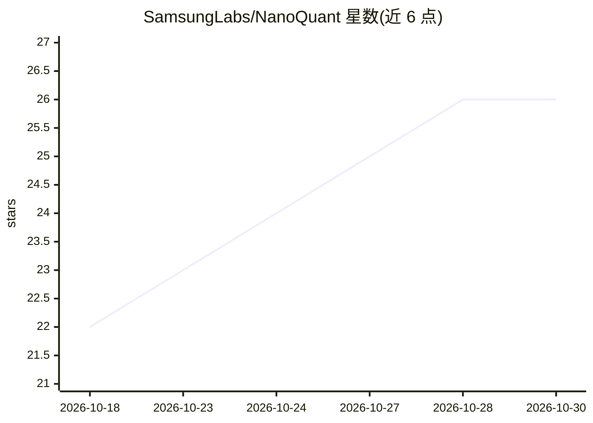

# SamsungLabs/NanoQuant

⭐ 26 · Python · Apache-2.0 · 推送 2026-07-03 · [GitHub](https://github.com/SamsungLabs/NanoQuant) · [官网](https://arxiv.org/abs/2602.06694) · 组织维护

**LLM 亚 1 比特后训练量化算法：无需重训练压缩模型权重**

ICML 2026 论文官方实现，来自 Samsung Labs。NanoQuant 是后训练量化（PTQ）算法：通过权重矩阵的非分解/分解表示与可学习的混合秩二值基，把 LLM 压缩到每权重 1 比特以下，仅靠校准数据、无需重训练；用 ADMM 迭代优化基并逐层补偿量化误差。提供自定义 CUDA GEMV/GEMM 内核，支持 OPT、Llama、Qwen、Gemma 等架构，README 报告解码速度最高提升 3 倍、内存占用缩小 10 倍（相对 FP16）。以 conda 环境从源码安装运行。

## 筛选速览

| 维度 | 判定 | 备注 |
|---|---|---|
| AI 角色 | `ai-ecosystem` | LLM/agent 周边工具 |
| 许可风险 | `permissive` | Apache-2.0 |
| 部署形态 | `None` |  |
| 模型依赖 | — | README 未给出锁定关系 |
| 硬件要求 | — | 无带数字的原话,不猜 |
| 安装摩擦 | `medium` | 含编译或系统依赖之一 |
| 成熟度 | — | 结构信号不足 |

## 能力要点

- 亚 1 比特权重压缩（混合秩二值基分解）
- PTQ 仅需校准数据，无需重训练
- 自定义 CUDA GEMV/GEMM 内核，不依赖 Tensor Cores
- 支持 OPT/Llama/Qwen/Gemma 架构，>70B 模型可 GPU+CPU 卸载

## 适用场景

- 把 Llama/Qwen 等模型压缩到亚 1 比特以降低部署显存
- 在不重训练的前提下给已有模型做校准式量化
- 对比二值内核与向量量化内核的解码性能

## 场景标签

`模型量化` · 领域:训练与推理

## 证据(README 行号)

> L9: **NanoQuant** is a **post-training quantization** algorithm that enables **sub-1-bit** LLM weight quantization.
> L19: * **Post-Training Quantization (PTQ):** No retraining required; calibration-only compression.

## 星数曲线

2026-10-18 22 → 2026-10-30 26（+4）

---
*卡片 v1 · prompt 1.4 · 生成 2026-10-27 · 置信度 high · 依据 README sha `fa32b4c6fcdb` · [字段定义](../../DATASET.md)*
