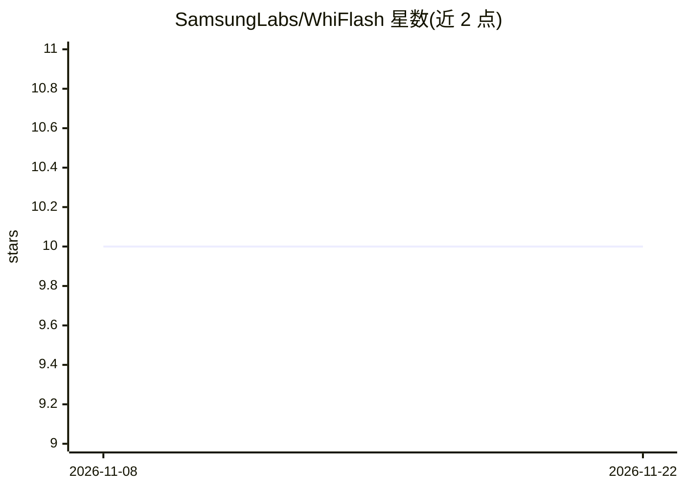

# SamsungLabs/WhiFlash

⭐ 10 · Python · NOASSERTION · 推送 2026-10-20 · [GitHub](https://github.com/SamsungLabs/WhiFlash) · [官网](https://samsunglabs.github.io/WhiFlash/) · 组织维护

**面向 LLM 研究者的投机解码加速方法实现：token 级路由两种 drafter**

三星研究院的投机解码研究项目，被 EMNLP 2026 接收。在每个解码步由 token 级路由器在自回归 drafter（EAGLE-3）与扩散并行 drafter（DFlash/DDTree）之间动态选择，提供无需训练的熵路由与需训练的 2 层 MLP 神经路由两种策略，配合 Lazy Catch-up 与 KV-only Prefill 两项系统优化降低切换开销。以源码形式发布，含 benchmark 脚本与 Hugging Face 上的已训练路由检查点；代码与检查点采用 CC BY-NC-SA 4.0 许可（非商业）。

## 筛选速览

| 维度 | 判定 | 备注 |
|---|---|---|
| AI 角色 | `ai-native` | 本体是模型或模型工具 |
| 许可风险 | `none` | NOASSERTION |
| 部署形态 | `None` |  |
| 模型依赖 | — | README 未给出锁定关系 |
| 硬件要求 | — | 无带数字的原话,不猜 |
| 安装摩擦 | `low` | 无编译、无系统依赖或容器化 |
| 成熟度 | — | 结构信号不足 |

## 能力要点

- token 级路由器逐步在 EAGLE-3 与 DFlash/DDTree 之间选择 drafter
- WhiFlash-Entropy 无需训练，基于目标模型下一 token 熵路由
- 提供 DDTree 树形验证 drafter，支持独立运行模式
- 发布 Qwen3-4B/8B 神经路由检查点与自训练的 EAGLE-3 drafter

## 适用场景

- 复现论文中的投机解码吞吐对比实验
- 为自研 LLM 接入跨范式投机解码加速
- 训练针对其他目标模型或 drafter 组合的神经路由器

## 场景标签

`模型评测` · 领域:评测与运维

## 证据(README 行号)

> L21: **WhiFlash** is the first **cross-paradigm** speculative decoding method: a lightweight **token-level router** that
> L33: WhiFlash addresses this volatility with a fine-grained controller that routes each decoding step to the highest-per

## 星数曲线

2026-11-08 10 → 2026-11-22 10（+0）

---
*卡片 v1 · prompt 1.4 · 生成 2026-11-20 · 置信度 high · 依据 README sha `5feffbde9c67` · [字段定义](../../DATASET.md)*
