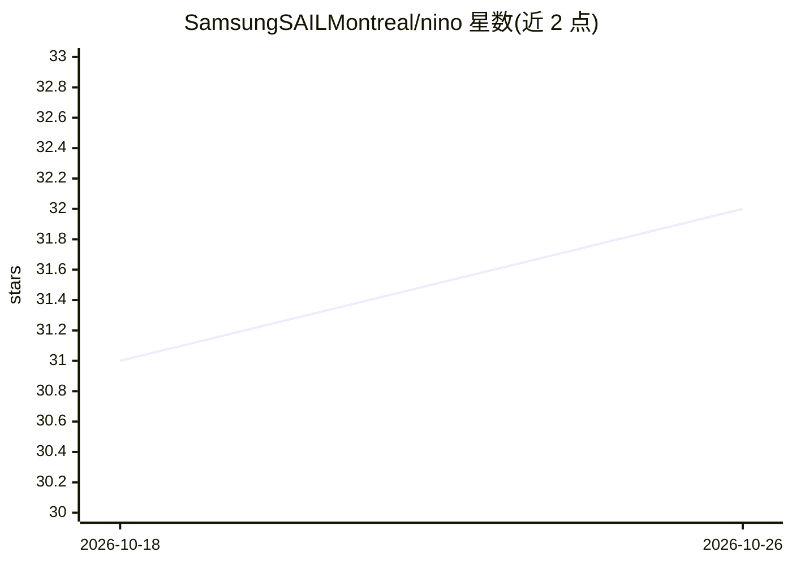

# SamsungSAILMontreal/nino

⭐ 32 · Python · MIT · 推送 2026-02-20 · [GitHub](https://github.com/SamsungSAILMontreal/nino) · [官网](https://arxiv.org/abs/2409.04434) · 组织维护

**用图神经网络预测未来参数以加速模型训练的研究代码（ICLR 2025）**

ICLR 2025 论文《Accelerating Training with Neuron Interaction and Nowcasting Networks》官方代码：NiNo 模型读取过去 c=5 个参数状态，基于神经图结构与 GNN 预测（nowcast）未来 K 个参数状态，每 1000 步 Adam 优化中应用一次。提供多个预训练 checkpoint、视觉/语言任务复现脚本，支持 GPT2/Llama/BERT/ViT/NanoGPT 等架构的图构建与评估；Llama3.2-1B 的 NiNo 步骤可借 --subgraph 与边采样在单张 80GB GPU 上完成（部分步骤需移至 CPU、约 300GB 内存）。附训练数据集（约 200GB）与训练代码，含模型合并脚本。实验需单张 ≤80GB 显存 GPU、Python≥3.8、PyTorch≥2.0。

## 筛选速览

| 维度 | 判定 | 备注 |
|---|---|---|
| AI 角色 | `ai-native` | 本体是模型或模型工具 |
| 许可风险 | `permissive` | MIT |
| 部署形态 | `None` |  |
| 模型依赖 | — | README 未给出锁定关系 |
| 硬件要求 | — | 无带数字的原话,不猜 |
| 安装摩擦 | `low` | 无编译、无系统依赖或容器化 |
| 成熟度 | `idea` | |

## 能力要点

- GNN 基于神经图预测未来参数状态，每 1k 步应用于一次 Adam 训练
- 提供 6 个预训练 NiNo checkpoint（含不用图的 WNN+ 变体）
- 支持 GPT2/Llama/BERT/ViT/NanoGPT 等架构的图构建与评估脚本
- --subgraph 与 --edge_sample_ratio 使 Llama3.2-1B 的 NiNo 步骤可在单 GPU 运行

## 适用场景

- 复现论文中视觉与语言任务的训练加速实验
- 在自有 LLM/视觉模型训练流程中接入 NiNo nowcasting
- 基于公开的 ~200GB 检查点数据集训练新的 NiNo 模型

## 场景标签

`模型训练` · 领域:训练与推理

## 证据(README 行号)

> L23: We introduce the NiNo model predicting future (nowcasting) parameters by learning neuron interaction
> L25: We feed c (c=5 by default) past parameter states as input to NiNo and
> L38: The experiments from our paper can be run using a single GPU with <= 80GB of memory.

## 星数曲线

2026-10-18 31 → 2026-10-26 32（+1）

---
*卡片 v1 · prompt 1.4 · 生成 2026-10-26 · 置信度 high · 依据 README sha `5c696963ef0d` · [字段定义](../../DATASET.md)*
