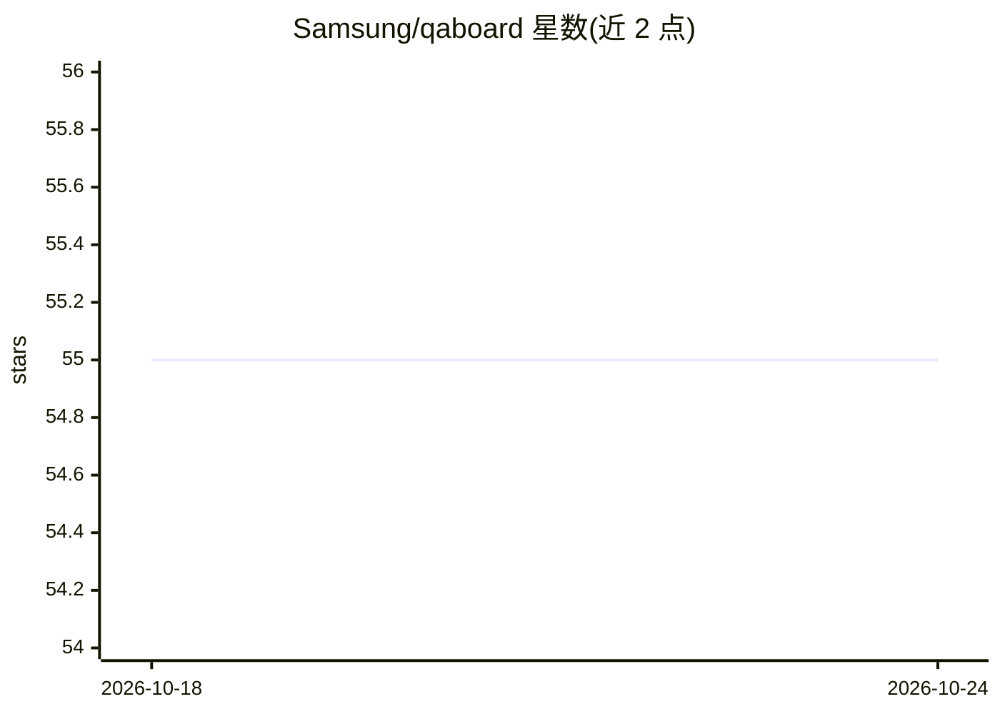

# Samsung/qaboard

⭐ 55 · JavaScript · Apache-2.0 · 推送 2026-10-23 · [GitHub](https://github.com/Samsung/qaboard) · [官网](https://samsung.github.io/qaboard) · 组织维护

**面向算法/ML/性能工程的实验追踪与可视化平台**

QA-Board 是开源的实验追踪框架，供算法、机器学习与性能工程师组织、查看与对比实验运行，支持调优/优化，并提供 Web 界面以可分享 URL 呈现结果。查看器支持量化指标及图像、视频、plotly 图表、文本、点云、HTML 等多种文件格式；框架与语言无关，可包装既有代码并读取其输出文件。集成 Git、CI（gitlabCI/jenkins/webhooks），通过 deployments/deploy.py 以 Docker 部署，README 未涉及 AI 模型本身。

## 筛选速览

| 维度 | 判定 | 备注 |
|---|---|---|
| AI 角色 | `ai-ecosystem` | LLM/agent 周边工具 |
| 许可风险 | `permissive` | Apache-2.0 |
| 部署形态 | `library` | 以包/库形式分发 |
| 模型依赖 | — | README 未给出锁定关系 |
| 硬件要求 | — | 无带数字的原话,不猜 |
| 安装摩擦 | `low` | 无编译、无系统依赖或容器化 |
| 成熟度 | — | 结构信号不足 |

## 能力要点

- 组织、查看与对比实验结果，支持参数调优/优化
- Web 界面提供可分享 URL 与多格式高级查看器（图像/视频/点云/plotly 等）
- 与 Git、CI 工具、webhooks 集成并提供 API
- 语言/框架无关：包装既有代码，读取输出文件

## 适用场景

- 算法团队集中管理并对比多次实验运行的结果
- 跨团队以链接分享实验视图与 KPI 报告
- 在 CI 流程中触发与记录调优实验

## 场景标签

`MLOps` · 领域:训练与推理

## 证据(README 行号)

> L3:  Experiment tracking framework with advanced viewers.
> L5:  Helps algo/ml/perf engineers share results, collaborate, and build better products.

## 星数曲线

2026-10-18 55 → 2026-10-24 55（+0）

---
*卡片 v1 · prompt 1.4 · 生成 2026-10-24 · 置信度 high · 依据 README sha `c66f28e73648` · [字段定义](../../DATASET.md)*
