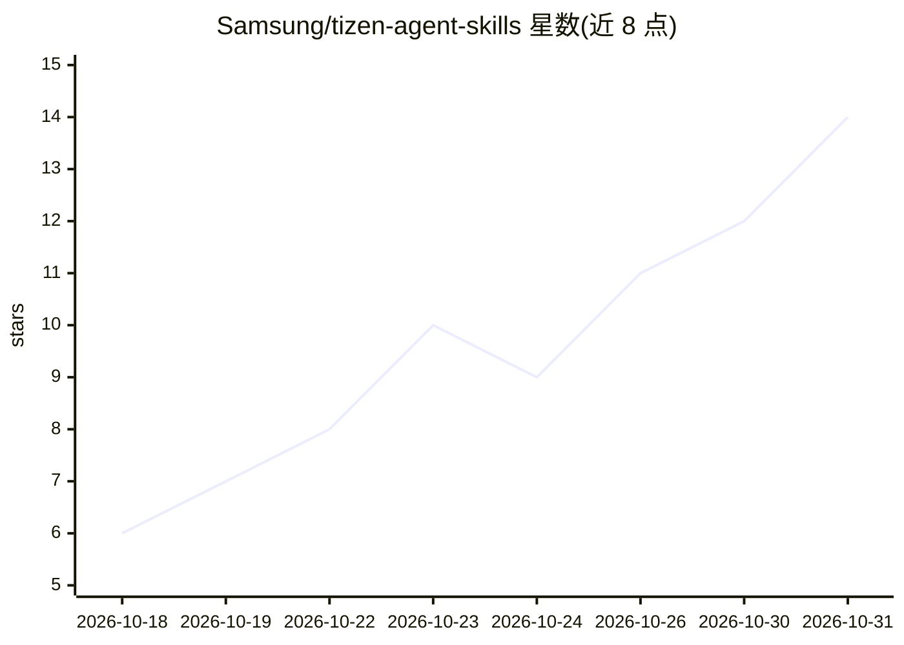

# Samsung/tizen-agent-skills

⭐ 14 · JavaScript · Apache-2.0 · 推送 2026-10-30 · [GitHub](https://github.com/Samsung/tizen-agent-skills) · [官网](https://github.com/Samsung/tizen-agent-skills#readme) · 组织维护

**Samsung 的 Tizen 开发 agent 技能与插件集，让 AI 编码助手操作 Tizen SDK**

Samsung 开源的 agent 技能与插件仓库，把 Tizen 平台开发环境带给 AI 编码助手。首个插件 tizen-sdk-skills 含 29 个技能与 24 个 agent，覆盖 Tizen SDK 安装、创建/构建 Web(.wgt)/Native(.tpk)/.NET/RPK/RPM 包、运行 Tizen 与 Samsung TV 模拟器、sdb 设备管理、签名、远程调试与 dlog 分析，另提供独立 tizen-sdk CLI 与 VS Code 扩展。第二个插件 tizen-action-skills 用于构建 Tizen Action Framework Provider。每个插件独立版本化，按宿主（Claude Code、Cline、Codex CLI 等）提供安装脚本。

## 筛选速览

| 维度 | 判定 | 备注 |
|---|---|---|
| AI 角色 | `ai-ecosystem` | LLM/agent 周边工具 |
| 许可风险 | `permissive` | Apache-2.0 |
| 部署形态 | `None` |  |
| 模型依赖 | — | README 未给出锁定关系 |
| 硬件要求 | — | 无带数字的原话,不猜 |
| 安装摩擦 | `medium` | 含编译或系统依赖之一 |
| 成熟度 | — | 结构信号不足 |

## 能力要点

- tizen-sdk-skills 含 29 个技能、24 个 agent 与独立 tizen-sdk CLI
- 覆盖 SDK 安装、构建、模拟器、调试（GDB/netcoredbg/CDP）、签名与 Playwright 测试
- tizen-action-skills 生成 C#/C++/JS/Flutter-Tizen 的 actionc/TIDL 存根并验证 Provider
- 每个插件按宿主提供独立安装脚本并独立版本发布

## 适用场景

- 让 Claude Code/Codex 等 AI 编码助手按自然语言指令完成 Tizen 应用构建与调试
- 自动化安装 Tizen SDK 与管理模拟器、设备
- 开发并注册供 Tizen 端上 AI Agent 调用的 Action Provider

## 场景标签

`编码 Agent` · 领域:编码与开发

## 证据(README 行号)

> L7: `tizen-agent-skills` is Samsung's open-source collection of agent skills and plugins that bring
> L10: plugin, `tizen-sdk-skills`, lets your agent install the Tizen SDK, create and build Tizen Web
> L26: |`tizen-sdk-skills/`|Automates the Tizen SDK end to end: SDK install, project creation, build, emulator and device 

## 星数曲线

2026-10-18 6 → 2026-10-31 14（+8）

---
*卡片 v1 · prompt 1.4 · 生成 2026-10-31 · 置信度 high · 依据 README sha `f194cfc9bde8` · [字段定义](../../DATASET.md)*
