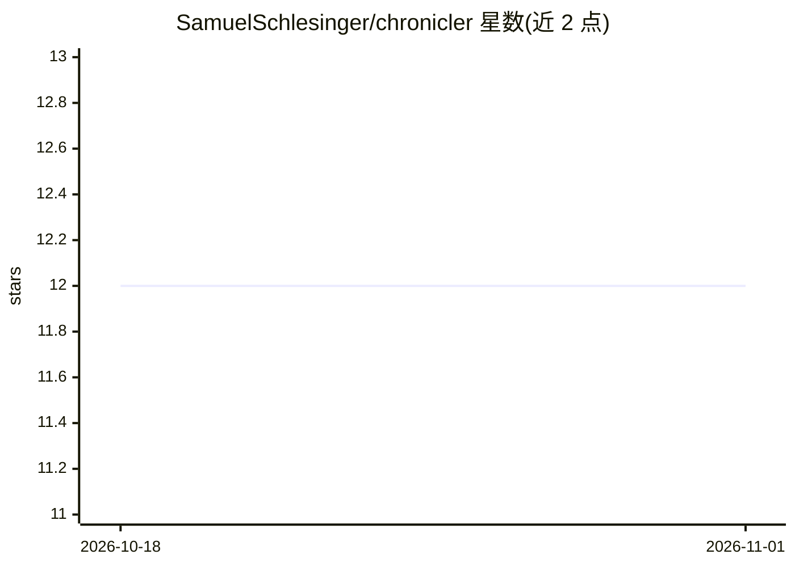

# SamuelSchlesinger/chronicler

⭐ 12 · Rust · NOASSERTION · 推送 2026-08-04 · [GitHub](https://github.com/SamuelSchlesinger/chronicler) · 个人维护

**单人跑团 RPG：AI 城主运行 D&D 5e 兼容世界并跨局记忆**

面向单人玩家的桌面跑团游戏，AI 扮演城主：叙述场景、配音 NPC、掷骰并跨会话追踪选择后果。后端可替换，支持 Anthropic、OpenAI、OpenRouter 或本地 Ollama 等 OpenAI 兼容服务；规则引擎、工具、记忆与存档与模型提供方无关。机制上采用意图/效果分离（AI 表达意图、规则引擎校验效果）、双模型架构（主模型叙事、快速模型做相关性检查与状态推断）、带重要性衰减的持久化故事记忆与延迟触发的后果种子。基于 Rust（Bevy + egui），从源码构建，需配置云端提供方或本地 Ollama 模型。许可证为 CC BY-NC 4.0（限非商业使用）。

## 筛选速览

| 维度 | 判定 | 备注 |
|---|---|---|
| AI 角色 | `ai-native` | 本体是模型或模型工具 |
| 许可风险 | `none` | NOASSERTION |
| 部署形态 | `None` |  |
| 模型依赖 | local-ok | 支持本地模型 |
| 硬件要求 | — | 无带数字的原话,不猜 |
| 安装摩擦 | `low` | 无编译、无系统依赖或容器化 |
| 成熟度 | — | 结构信号不足 |

## 能力要点

- 规则引擎机械裁决技能检定、豁免与战斗，AI 不直接改写游戏状态
- 持久化故事记忆：事实按回合衰减，跨会话后果自然浮现
- 双模型架构：主模型叙事，快速模型跑触发检查与状态推断
- 后端可替换：Anthropic/OpenAI/OpenRouter/本地 Ollama，存档跨提供方通用

## 适用场景

- 一个人玩有连续记忆和规则裁决的 D&D 5e 跑团
- 换不同模型（本地或云端）继续同一局存档
- 研究长期一致性 storytelling agent 的设计技巧

## 场景标签

 · 领域:游戏/AI 叙事

## 证据(README 行号)

> L11: A solo tabletop RPG with a replaceable AI backend. Use Anthropic, OpenAI,
> L13: runs the world — narrating scenes, voicing NPCs, rolling dice, and tracking the

## 星数曲线

2026-10-18 12 → 2026-11-01 12（+0）

---
*卡片 v1 · prompt 1.4 · 生成 2026-11-01 · 置信度 high · 依据 README sha `82ce7c1cfc98` · [字段定义](../../DATASET.md)*
