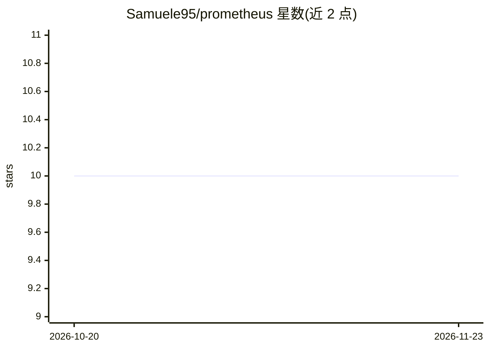

# Samuele95/prometheus

⭐ 10 · Python · MIT · 推送 2026-11-17 · [GitHub](https://github.com/Samuele95/prometheus) · [官网](https://samuele95.github.io/prometheus/) · 个人维护

**面向 agent 开发者的构建期元提示词框架，设计、审计并验证提示词**

以 agent skill 形式分发的构建期元提示词框架：将提示词视为算子，按七种形状与三种模式（从零设计、重构、MAPE-K 生命周期管理）生成提示词、agent 与多步工作流，每个交付物附带静态/单次运行/跨运行三层验证器。安装方式为克隆仓库后复制到宿主 agent 的技能搜索路径，无构建步骤、无依赖，另提供 Gemini Gem 免文件系统移植版。

## 筛选速览

| 维度 | 判定 | 备注 |
|---|---|---|
| AI 角色 | `ai-ecosystem` | LLM/agent 周边工具 |
| 许可风险 | `permissive` | MIT |
| 部署形态 | `None` |  |
| 模型依赖 | — | README 未给出锁定关系 |
| 硬件要求 | — | 无带数字的原话,不猜 |
| 安装摩擦 | `low` | 无编译、无系统依赖或容器化 |
| 成熟度 | — | 结构信号不足 |

## 能力要点

- 六阶段流程：Shape→Interview→Draft→Audit→Score→Deliver
- 每个交付物附带静态、单次运行、跨运行三层 verifier
- MAPE-K 循环对已部署 agent 做生命周期管理（控制面/数据面分离）
- 五种多 agent 拓扑及对应失败模式清单

## 适用场景

- 为 Claude Code / Cursor 等 agent 运行时设计系统提示词
- 审计并重构现有 agent 的提示词与工作流
- 对线上 agent 做持续管理与回归防护
- 构建带验证器的 LLM-as-judge 评分器

## 场景标签

`提示工程` · 领域:Agent 开发

## 证据(README 行号)

> L5: **A meta-prompting framework for agentic systems.**
> L81: Prometheus is a portable **agent skill** and a build-time engine for **agentic
> L84: a verifier. It runs entirely at **build time**: it designs, audits, refactors, and

## 星数曲线

2026-10-20 10 → 2026-11-23 10（+0）

---
*卡片 v1 · prompt 1.4 · 生成 2026-11-20 · 置信度 high · 依据 README sha `0eb7bfb028a1` · [字段定义](../../DATASET.md)*
