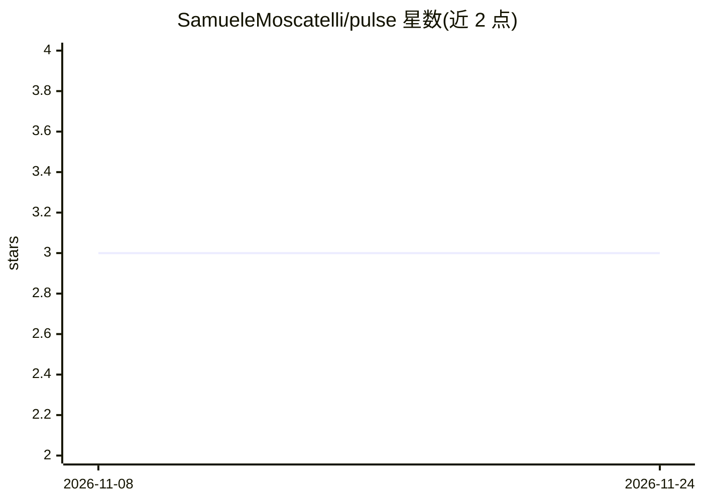

# SamueleMoscatelli/pulse

⭐ 3 · Rust · Apache-2.0 · 推送 2026-11-23 · [GitHub](https://github.com/SamueleMoscatelli/pulse) · 个人维护

**AI 资产静态分析与质量门禁 CLI：扫描安全、token 冗余与矛盾**

一个离线运行的静态分析器与 Quality Gate：扫描仓库中引导编码代理的资产（CLAUDE.md、AGENTS.md、Copilot/Cursor 等规则、agents、skills、prompts、MCP 配置与 hooks），检测隐藏 Unicode、prompt injection、硬编码凭据、权限过大、token 膨胀、重复内容与指令矛盾等，输出 terminal/json/sarif/markdown/github 报告并给出 A–E 评级。可作为 pre-commit 钩子、GitHub Action 或 CI 中运行，`pulse ci` 在质量门禁失败时以退出码 1 结束。单二进制、语义化版本承诺规则 ID 与报告 schema 兼容。

## 筛选速览

| 维度 | 判定 | 备注 |
|---|---|---|
| AI 角色 | `ai-ecosystem` | LLM/agent 周边工具 |
| 许可风险 | `permissive` | Apache-2.0 |
| 部署形态 | `library` | 以包/库形式分发 |
| 模型依赖 | — | README 未给出锁定关系 |
| 硬件要求 | — | 无带数字的原话,不猜 |
| 安装摩擦 | `medium` | 含编译或系统依赖之一 |
| 成熟度 | — | 结构信号不足 |

## 能力要点

- 单二进制离线扫描，毫秒级完成，可在 pre-commit/编辑器/CI 以相同方式运行
- 33 条规则覆盖安全（AI-SEC）、效率（AI-EFF）、结构（AI-STR）、认知（AI-COG）四类
- 计算各助手的 always-on 上下文负载与 context debt，默认 8k token 预算
- 支持 baseline 接受存量发现、--new-only 只对新发现做门禁

## 适用场景

- 在 CI 中把 AI 资产质量门禁接入 PR 流程
- 提交前扫描 CLAUDE.md 与 MCP 配置中的 prompt injection 与凭据泄漏
- 削减代理每次请求加载的 token 开销

## 场景标签

`网络安全` · 领域:学习与行业

## 证据(README 行号)

> L6: **A static analyzer and Quality Gate for AI assets**: the instructions, agents, prompts,
> L8: "SonarQube for AI assets": one deterministic, offline binary that scans a repository in
> L46: pulse ci                   # scan + enforce the Quality Gate (exit 1 when it fails)

## 星数曲线

2026-11-08 3 → 2026-11-24 3（+0）

---
*卡片 v1 · prompt 1.4 · 生成 2026-11-22 · 置信度 high · 依据 README sha `585eafdeebb1` · [字段定义](../../DATASET.md)*
