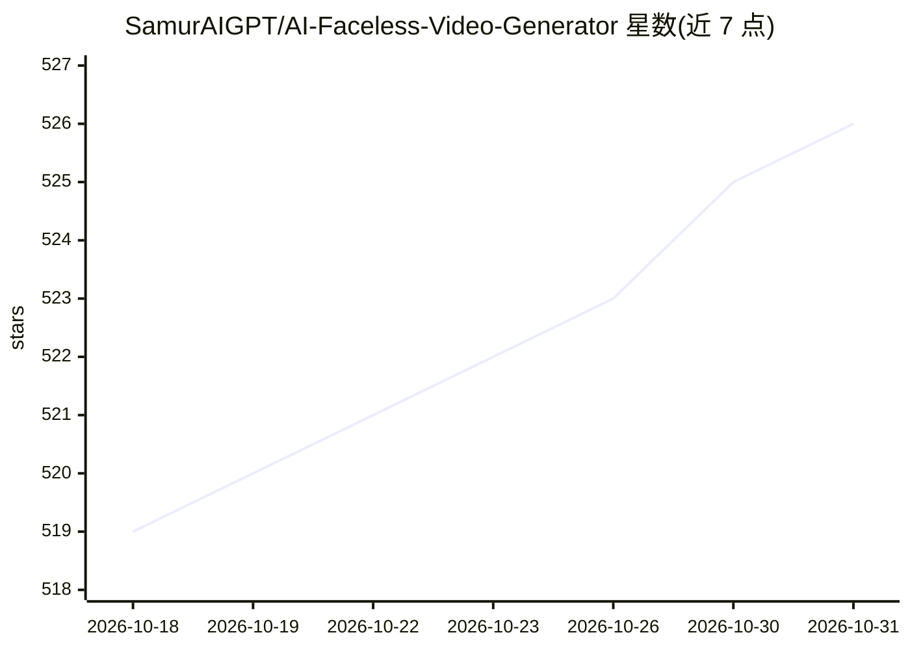

# SamurAIGPT/AI-Faceless-Video-Generator

⭐ 526 · Jupyter Notebook · MIT · 推送 2026-09-17 · [GitHub](https://github.com/SamurAIGPT/AI-Faceless-Video-Generator) · [官网](https://www.vadoo.tv/ai-faceless-video-generator) · 个人维护

**输入主题自动生成口播脚本、语音与说话头像视频的工具**

端到端的无出镜视频生成流程：输入主题后由 OpenAI GPT 生成脚本，gTTS 转为语音，SadTalker 将任意人脸图片驱动为与音频同步的说话头像，输出完整口播视频。提供 Google Colab 笔记本（推荐）与本地安装两种使用方式；本地运行需 Python 3.8+、OpenAI API key，SadTalker 推荐 GPU。README 另指向 Vadoo AI API 作为免搭建的替代方案。

## 筛选速览

| 维度 | 判定 | 备注 |
|---|---|---|
| AI 角色 | `ai-native` | 本体是模型或模型工具 |
| 许可风险 | `permissive` | MIT |
| 部署形态 | `None` |  |
| 模型依赖 | — | README 未给出锁定关系 |
| 硬件要求 | — | 无带数字的原话,不猜 |
| 安装摩擦 | `low` | 无编译、无系统依赖或容器化 |
| 成熟度 | — | 结构信号不足 |

## 能力要点

- 主题→GPT 脚本→gTTS 语音→SadTalker 头像动画的完整流水线
- 支持用任意人脸图片作为视频出镜者
- 提供 Google Colab 一键运行笔记本

## 适用场景

- 批量制作无出镜口播短视频
- 从一句话主题自动产出带配音的说话头像视频
- 不想本地配置 GPU 时用 Colab 直接生成视频

## 场景标签

`视频生成` `语音合成` · 领域:内容生成

## 证据(README 行号)

> L8: Generate talking face videos from just a topic using AI. Combines script generation, text-to-speech, and face animat
> L30: Topic Input → GPT Script → gTTS Voice → SadTalker Animation → Video Output

## 星数曲线

2026-10-18 519 → 2026-10-31 526（+7）

---
*卡片 v1 · prompt 1.4 · 生成 2026-10-21 · 置信度 high · 依据 README sha `6276705030e6` · [字段定义](../../DATASET.md)*
