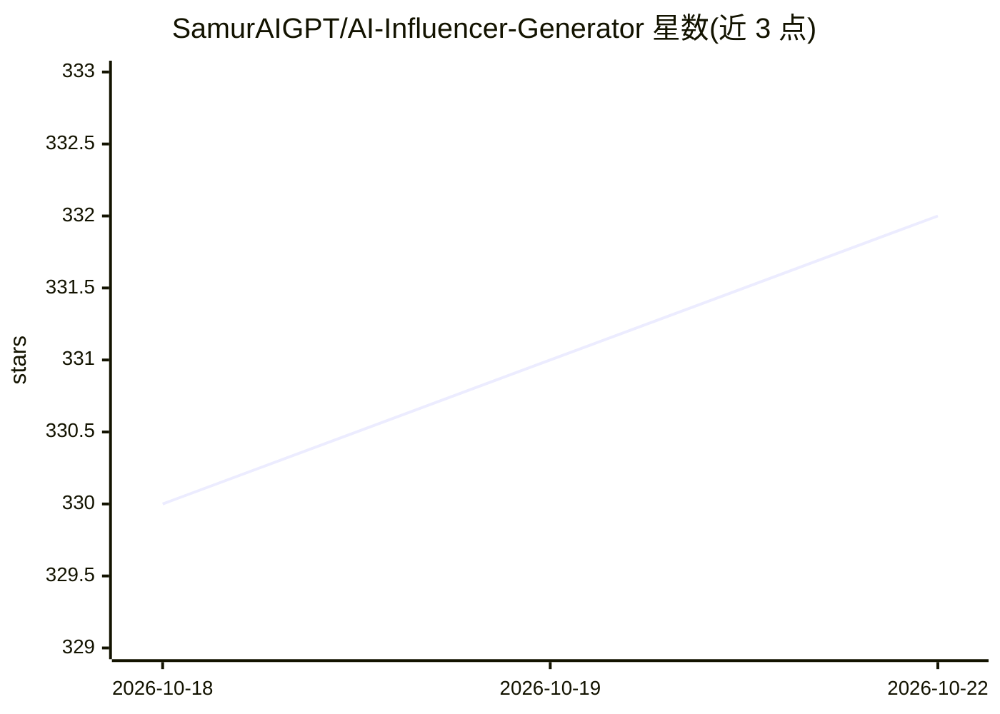

# SamurAIGPT/AI-Influencer-Generator

⭐ 332 · Jupyter Notebook · MIT · 推送 2026-08-02 · [GitHub](https://github.com/SamurAIGPT/AI-Influencer-Generator) · [官网](https://vadoo.tv/ai-influencer-generator) · 个人维护

**生成虚拟 AI 网红内容：人物图像、语音、口型视频**

开源的 AI 网红内容生成工具：以 Stable Diffusion 生成一致的人物形象图像，gTTS 将脚本转为语音，SadTalker 生成口型同步的说话视频，流程为 Prompt→图像→音频→视频→内容。核心功能不依赖付费 API，另使用 OpenAI GPT 生成提示词。提供 Google Colab notebook 与本地 git clone 两种运行方式，面向想在社交平台发布 AI 虚拟角色内容的使用者。

## 筛选速览

| 维度 | 判定 | 备注 |
|---|---|---|
| AI 角色 | `ai-native` | 本体是模型或模型工具 |
| 许可风险 | `permissive` | MIT |
| 部署形态 | `None` |  |
| 模型依赖 | — | README 未给出锁定关系 |
| 硬件要求 | — | 无带数字的原话,不猜 |
| 安装摩擦 | `low` | 无编译、无系统依赖或容器化 |
| 成熟度 | — | 结构信号不足 |

## 能力要点

- Stable Diffusion 生成并保持一致的 AI 人物形象
- gTTS 文本转语音与 SadTalker 口型同步动画
- 核心功能不依赖付费 API，提供 Colab 一键运行

## 适用场景

- 为 Instagram/TikTok/YouTube 生成虚拟网红内容
- 创建虚拟品牌代言人形象与说话视频
- 制作 AI 讲解者/虚拟主持人的教育内容

## 场景标签

`图像生成` `视频生成` `语音合成` · 领域:内容生成

## 证据(README 行号)

> L30: - **AI Image Generation** - Create unique influencer personas with Stable Diffusion
> L39: Prompt → Stable Diffusion Image → gTTS Audio → SadTalker Video → AI Influencer Content

## 星数曲线

2026-10-18 330 → 2026-10-22 332（+2）

---
*卡片 v1 · prompt 1.4 · 生成 2026-10-21 · 置信度 high · 依据 README sha `8f466010ddf7` · [字段定义](../../DATASET.md)*
