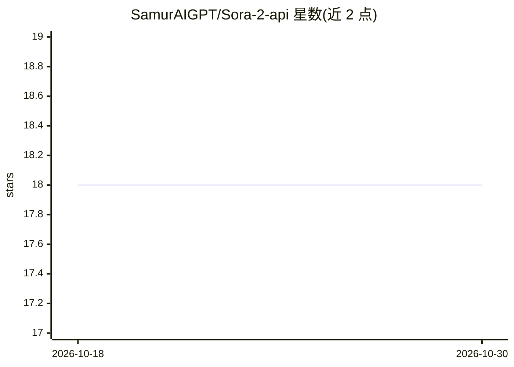

# SamurAIGPT/Sora-2-api

⭐ 18 · MIT · 推送 2026-08-02 · [GitHub](https://github.com/SamurAIGPT/Sora-2-api) · [官网](https://muapi.ai/playground/openai-sora-2-text-to-video) · 组织维护

**通过 muapi.ai 调用 OpenAI Sora 2 文生视频模型的 Python API 封装**

封装 muapi.ai 平台上的 OpenAI Sora 2 文生视频接口的 Python 客户端：提交文本提示词生成带音频的视频，支持 720p/1080p 分辨率与 16:9/9:16/1:1 宽高比，采用提交任务+轮询状态的异步模式获取结果。需 Python 3.7+ 与 muapi.ai API key，通过 .env 配置密钥，git clone 源码并 pip 安装 requests、python-dotenv 依赖后运行。

## 筛选速览

| 维度 | 判定 | 备注 |
|---|---|---|
| AI 角色 | `ai-ecosystem` | LLM/agent 周边工具 |
| 许可风险 | `permissive` | MIT |
| 部署形态 | `library` | 以包/库形式分发 |
| 模型依赖 | — | README 未给出锁定关系 |
| 硬件要求 | — | 无带数字的原话,不猜 |
| 安装摩擦 | `low` | 无编译、无系统依赖或容器化 |
| 成熟度 | — | 结构信号不足 |

## 能力要点

- 文本生成带音频视频（Sora 2 模型，经 muapi.ai 通道）
- 可选分辨率 720p/1080p 与三种宽高比
- 提交任务并轮询 request_id 获取结果的异步流程
- REST 端点文档：提交任务与查询结果两个接口

## 适用场景

- 在自己的 Python 应用中接入 Sora 2 文生视频能力
- 批量或程序化生成带音效的短视频内容
- 集成到需要视频产出的自动化流水线

## 场景标签

`视频生成` · 领域:内容生成

## 证据(README 行号)

> L3: Access OpenAI's Sora 2 text-to-video generation model with audio through the muapi.ai API.
> L14: - **Text-to-Video Generation** - Generate videos from text prompts using OpenAI's Sora 2 model

## 星数曲线

2026-10-18 18 → 2026-10-30 18（+0）

---
*卡片 v1 · prompt 1.4 · 生成 2026-10-29 · 置信度 mid · 依据 README sha `c9f414f42165` · [字段定义](../../DATASET.md)*
