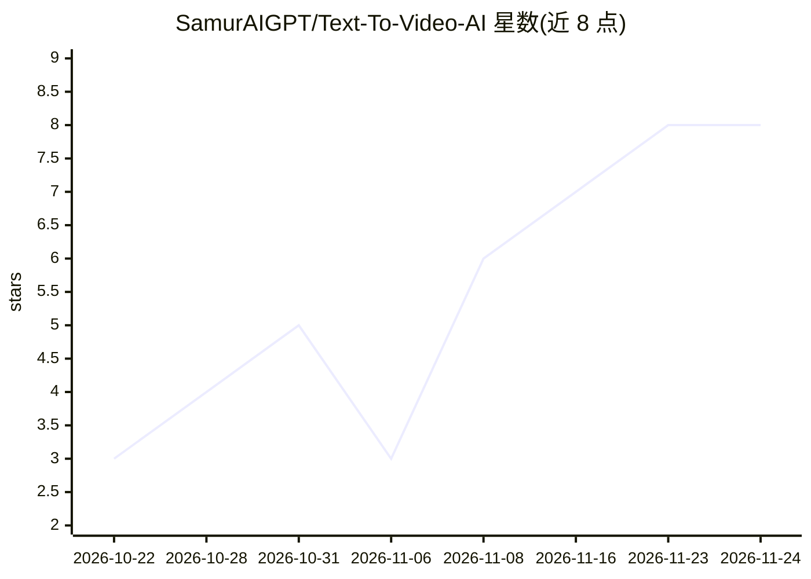

# SamurAIGPT/Text-To-Video-AI

⭐ 8 · Jupyter Notebook · MIT · 推送 2026-10-08 · [GitHub](https://github.com/SamurAIGPT/Text-To-Video-AI) · [官网](https://www.vadoo.tv/text-to-video-ai) · 组织维护

**从文本提示自动生成带配音字幕的短视频**

输入一个主题后自动完成脚本生成、配音、字幕与背景视频拼合，输出 rendered_video.mp4，面向制作 YouTube Shorts/Reels/TikTok 类竖屏或横屏视频的用户。脚本生成可选 OpenAI/Groq/Gemini，TTS 提供 EdgeTTS（免费）或 ElevenLabs，字幕时间轴用 Whisper/Deepgram，B-roll 取自 Pexels，AI 视频片段经 MuAPI 调用多种文生视频模型。需 Python 3.8+、FFmpeg、ImageMagick 及多项 API key；另有免安装的付费 API 与 Colab 运行方式。

## 筛选速览

| 维度 | 判定 | 备注 |
|---|---|---|
| AI 角色 | `ai-native` | 本体是模型或模型工具 |
| 许可风险 | `permissive` | MIT |
| 部署形态 | `None` |  |
| 模型依赖 | locked-api |  |
| 硬件要求 | — | 无带数字的原话,不猜 |
| 安装摩擦 | `medium` | 含编译或系统依赖之一 |
| 成熟度 | — | 结构信号不足 |

## 能力要点

- 多 LLM 提供方可选：OpenAI、Groq、Google Gemini
- EdgeTTS 免费配音或 ElevenLabs，字幕支持字体/颜色/位置自定义
- 经 MuAPI 接入 Veo3、Seedance、Kling、Sora 等 30+ 文生视频模型
- 支持竖屏 9:16 与横屏 16:9 两种输出方向

## 适用场景

- 批量制作 YouTube Shorts / Instagram Reels / TikTok 短视频
- 无需真人出镜的科普或主题解说视频生成
- 为文案自动配上配音、字幕和 B-roll 素材

## 场景标签

`视频生成` · 领域:内容生成

## 证据(README 行号)

> L5: Generate engaging videos from text prompts using AI. Perfect for creating YouTube Shorts, Instagram Reels, TikTok vi
> L31: - **AI-Powered Script Generation** - Automatically generates engaging scripts from any topic
> L123: MUAPI_VIDEO_MODEL=veo3-fast-text-to-video

## 星数曲线

2026-10-22 3 → 2026-11-24 8（+5）

---
*卡片 v1 · prompt 1.4 · 生成 2026-11-20 · 置信度 high · 依据 README sha `f38aa88274f7` · [字段定义](../../DATASET.md)*
