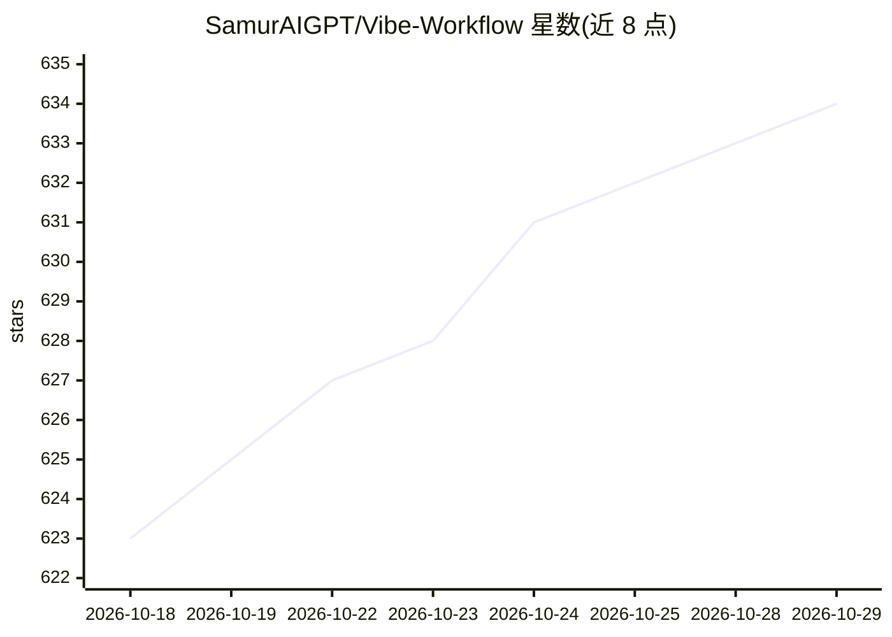

# SamurAIGPT/Vibe-Workflow

⭐ 634 · JavaScript · MIT · 推送 2026-09-17 · [GitHub](https://github.com/SamurAIGPT/Vibe-Workflow) · [官网](https://muapi.ai/workflow) · 组织维护

**自托管的可视化节点式 AI 图像/视频工作流构建器**

基于节点画布的生成式 AI 工作流构建器，供创作者与开发者可视化搭建、编辑图像与视频生成流水线。前端为 Next.js，后端为 FastAPI，生成能力通过 MuAPI（Vadoo AI）的 API key 接入；支持自定义模型节点、外部 API 与可复用模板。支持 Docker Compose 一键部署，也提供 muapi.ai/workflow 托管版（含 API 与 embed 嵌入）。自称可替代 Weavy AI、Krea Nodes、Freepik Spaces、FloraFauna AI 等付费产品，MIT 许可。

## 筛选速览

| 维度 | 判定 | 备注 |
|---|---|---|
| AI 角色 | `ai-native` | 本体是模型或模型工具 |
| 许可风险 | `permissive` | MIT |
| 部署形态 | `self-host` | docker 或自建部署 |
| 模型依赖 | — | README 未给出锁定关系 |
| 硬件要求 | — | 无带数字的原话,不猜 |
| 安装摩擦 | `low` | 无编译、无系统依赖或容器化 |
| 成熟度 | — | 结构信号不足 |

## 能力要点

- 可视化节点式流水线编辑器，支持图像与视频生成
- 自托管运行，数据不发送至第三方 SaaS
- 可添加自定义模型节点、外部 API 与可复用工作流模板
- 提供 Docker Compose 部署与托管版（含 API/embed 支持）

## 适用场景

- 可视化搭建批量生成图像素材的 AI 流水线
- 在自有服务器上编排视频生成任务
- 通过 API 将节点式 AI 工作流嵌入自己的产品

## 场景标签

`工作流自动化` `图像生成` `视频生成` · 领域:效率与自动化

## 证据(README 行号)

> L3: **Vibe Workflow** is a free, open-source node-based AI workflow builder — the self-hostable alternative to Weavy AI,
> L55: - **Generative Image & Video** — Integrated support for image and video generation powered by **MuAPI** (Vadoo AI).

## 星数曲线

2026-10-18 623 → 2026-10-29 634（+11）

---
*卡片 v1 · prompt 1.4 · 生成 2026-10-21 · 置信度 high · 依据 README sha `2b18a3aece70` · [字段定义](../../DATASET.md)*
