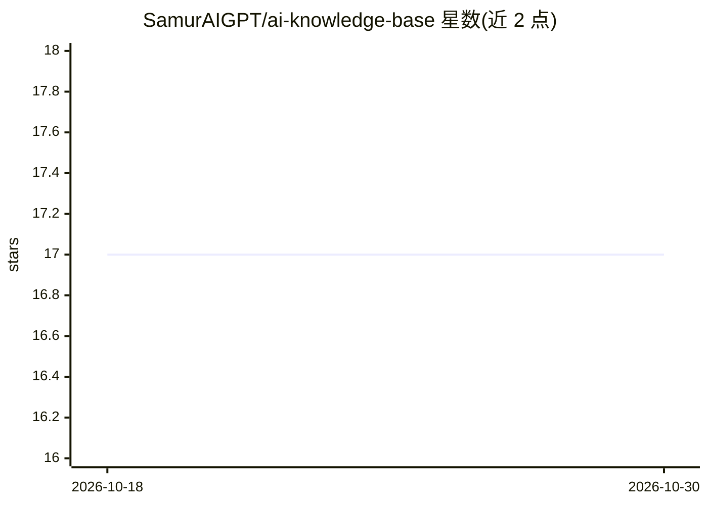

# SamurAIGPT/ai-knowledge-base

⭐ 17 · JavaScript · 推送 2026-07-27 · [GitHub](https://github.com/SamurAIGPT/ai-knowledge-base) · [官网](https://muapi.ai?utm_source=github&utm_medium=about&utm_campaign=ai-knowledge-base) · 组织维护

**自托管知识库 RAG 聊天机器人构建平台（Next.js SaaS）**

基于 Next.js 14 的可自托管 SaaS 应用：用户创建知识库，通过上传文档、抓取 URL 或录入 Q&A 训练数据，在对话场域中以语义检索注入上下文并给出引用来源，可生成 iframe 脚本嵌入第三方网站。内置 Google OAuth 登录与 Stripe 积分计费（$1=200 积分，训练/提问按积分扣费）。LLM 能力通过 MuAPI（muapi.ai API key）接入，面向 Vercel 部署，本地开发需 Node.js 18+ 与 PostgreSQL。

## 筛选速览

| 维度 | 判定 | 备注 |
|---|---|---|
| AI 角色 | `ai-native` | 本体是模型或模型工具 |
| 许可风险 | `none` | — |
| 部署形态 | `library` | 以包/库形式分发 |
| 模型依赖 | — | README 未给出锁定关系 |
| 硬件要求 | — | 无带数字的原话,不猜 |
| 安装摩擦 | `low` | 无编译、无系统依赖或容器化 |
| 成熟度 | — | 结构信号不足 |

## 能力要点

- 文档上传/URL 抓取/Q&A 三种数据源训练知识库
- 回答带引用来源与片段预览
- iframe 嵌入式聊天机器人小组件与 API 访问
- 内置 Google OAuth 与 Stripe 积分计费体系

## 适用场景

- 在自有文档上搭建带引用的客服问答机器人
- 内部文档问答与知识管理
- 把定制聊天机器人嵌入官网或落地页

## 场景标签

`聊天机器人` `文档问答` · 领域:对话与助手

## 证据(README 行号)

> L3: > **Build custom AI chatbots trained on your documents, URLs, and Q&A data — with citations, embed widgets, and real
> L5: **Tech stack:** Next.js 14 (App Router) · Prisma · PostgreSQL · NextAuth (Google OAuth) · Stripe · Tailwind CSS · Mu
> L30: - **High-Contrast Playground** — Chat dynamically with custom bots showing exact reference matches and citation sou

## 星数曲线

2026-10-18 17 → 2026-10-30 17（+0）

---
*卡片 v1 · prompt 1.4 · 生成 2026-10-29 · 置信度 high · 依据 README sha `9019ccbc134b` · [字段定义](../../DATASET.md)*
