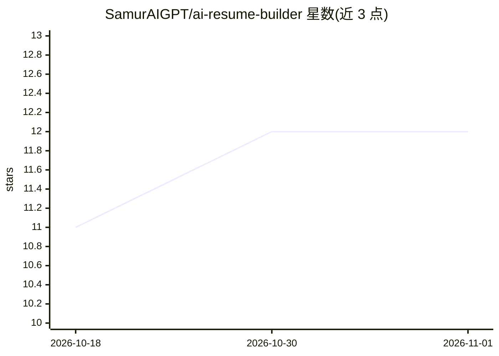

# SamurAIGPT/ai-resume-builder

⭐ 12 · JavaScript · 推送 2026-07-27 · [GitHub](https://github.com/SamurAIGPT/ai-resume-builder) · [官网](https://muapi.ai?utm_source=github&utm_medium=about&utm_campaign=ai-resume-builder) · 组织维护

**自托管 AI 简历生成与 ATS 优化 SaaS 模板（Next.js）**

基于 Next.js 14 (App Router)、Prisma/PostgreSQL、NextAuth (Google OAuth) 与 Stripe 的生产可部署 SaaS 应用：用户按步骤填写个人资料、工作经历、项目与技能，附带语气/目标岗位等写作指令，由 MuAPI 引擎生成以动词与量化指标为导向的 ATS 优化简历；提供 6 种模板、字体与尺寸定制、创作历史持久化、公共分享链接及 PDF/Word 导出。AI 生成按积分计费（每次 18 积分），Stripe 结算四档积分包。部署面向 Vercel serverless，需配置数据库、OAuth、Stripe 与 MuAPI 密钥等环境变量；本地开发需 Node.js v18+ 与 PostgreSQL。

## 筛选速览

| 维度 | 判定 | 备注 |
|---|---|---|
| AI 角色 | `ai-native` | 本体是模型或模型工具 |
| 许可风险 | `none` | — |
| 部署形态 | `library` | 以包/库形式分发 |
| 模型依赖 | — | README 未给出锁定关系 |
| 硬件要求 | — | 无带数字的原话,不猜 |
| 安装摩擦 | `low` | 无编译、无系统依赖或容器化 |
| 成熟度 | — | 结构信号不足 |

## 能力要点

- AI 生成以动词与量化指标为导向的 ATS 优化简历（MuAPI 引擎）
- 6 种模板与字体、文档尺寸定制，PDF/Word 导出与公共分享链接
- NextAuth Google 登录、Stripe 积分计费与创作历史持久化
- Vercel 一键部署与本地开发流程（Prisma 同步循环）

## 适用场景

- 求职者自助生成并优化 ATS 友好的简历
- 职业教练或高校就业中心搭建自托管简历服务
- 作为带积分计费与认证的 Next.js SaaS 模板二次开发

## 场景标签

`AI 写作` · 领域:内容生成

## 证据(README 行号)

> L3: > **Generate professional, metrics-driven, ATS-optimized resumes with AI in seconds.** A production-ready, self-host
> L35: - **Kinetic Document Workstation** — Submit customized writing instructions (tone, focus, target role) alongside st
> L39: - **Credit Tiers & Stripe Billing** — Fully integrated checkout sessions with Stripe. Purchase one-time package cre

## 星数曲线

2026-10-18 11 → 2026-11-01 12（+1）

---
*卡片 v1 · prompt 1.4 · 生成 2026-11-01 · 置信度 mid · 依据 README sha `6bb07d086129` · [字段定义](../../DATASET.md)*
