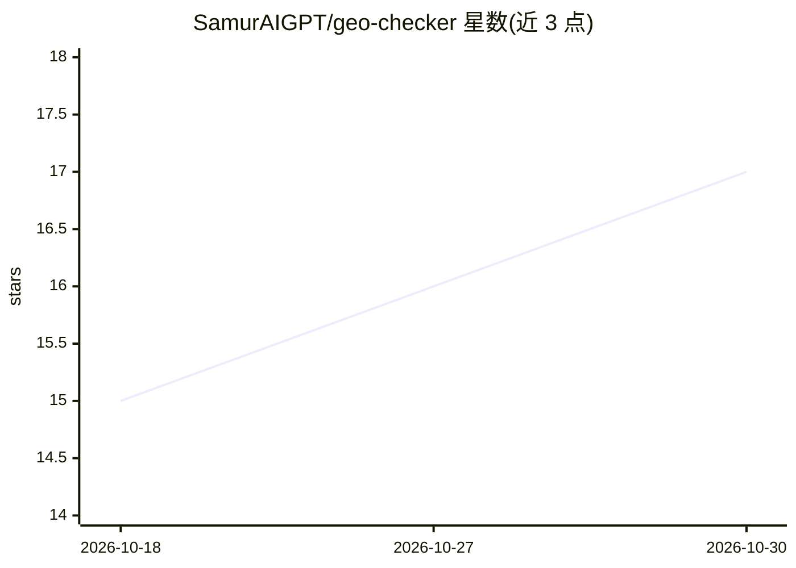

# SamurAIGPT/geo-checker

⭐ 17 · JavaScript · 推送 2026-08-02 · [GitHub](https://github.com/SamurAIGPT/geo-checker) · 组织维护

**自托管 GEO 审计 SaaS：检测落地页被 AI 搜索引擎引用的情况**

基于 Next.js 14（App Router）的可自托管 SaaS 应用：用户输入落地页 URL 与目标关键词，选择 ChatGPT Search、Perplexity、Gemini 等 AI 搜索引擎，系统抓取页面 HTML 并通过 MuAPI（Gemini 2.5 Flash）异步生成 AI 可见性评分与优化建议，结果经 webhook 写入 PostgreSQL，可在画廊页查看、对比、导出 JSON。内置 Google OAuth 登录、Stripe 积分计费（18 积分/次审计）与四档积分包。面向营销人员、SEO 代理与开发者，部署依赖 Vercel、PostgreSQL 及多项外部服务密钥；README 提示共享数据库 schema 下需按 Pull-Declare-Push-Cleanup 流程操作以免误删表。

## 筛选速览

| 维度 | 判定 | 备注 |
|---|---|---|
| AI 角色 | `ai-native` | 本体是模型或模型工具 |
| 许可风险 | `none` | — |
| 部署形态 | `library` | 以包/库形式分发 |
| 模型依赖 | — | README 未给出锁定关系 |
| 硬件要求 | — | 无带数字的原话,不猜 |
| 安装摩擦 | `low` | 无编译、无系统依赖或容器化 |
| 成熟度 | — | 结构信号不足 |

## 能力要点

- 对多 AI 搜索引擎（ChatGPT Search/Perplexity/Gemini 等 5 种）的页面引用可见性模拟审计
- MuAPI 异步 webhook 生成结果，报告存 PostgreSQL 并支持导出 JSON
- 内置 NextAuth Google 登录与 Stripe 积分计费（$1=200 积分，无订阅制）
- 面向 Vercel Serverless 架构，提供一键部署与逐步部署指南

## 适用场景

- 营销代理为客户生成落地页 AI 搜索可见性报告
- 上线前对落地页做 GEO 优化检查
- 内容团队研究页面在 AI 搜索中的引用与排名表现

## 场景标签

`网页抓取` `数据分析` · 领域:效率与自动化

## 证据(README 行号)

> L3: > **Audit your landing page's AI search visibility and citation potential in seconds.** A production-ready, self-hos
> L33: - **Webhook-Backed AI Delivery** — MuAPI async webhook delivers results directly into the database (`/api/webhook/m

## 星数曲线

2026-10-18 15 → 2026-10-30 17（+2）

---
*卡片 v1 · prompt 1.4 · 生成 2026-10-30 · 置信度 high · 依据 README sha `ef3a22ed038e` · [字段定义](../../DATASET.md)*
