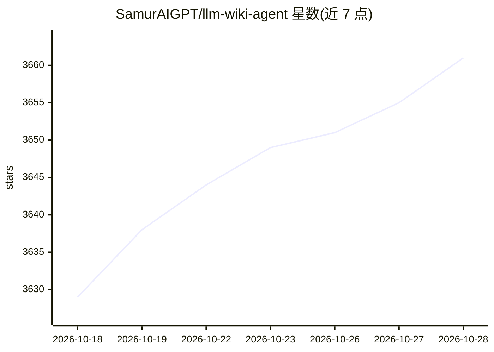

# SamurAIGPT/llm-wiki-agent

⭐ 3,661 · Python · MIT · 推送 2026-10-26 · [GitHub](https://github.com/SamurAIGPT/llm-wiki-agent) · 个人维护

**让编码代理自动摄入文档并维护持久互联知识库的技能**

面向 Claude Code / Codex / OpenCode / Gemini CLI 等编码代理的技能包：将源文档放入 raw/ 并触发 ingest，由宿主代理读取、抽取知识并生成持续维护的结构化 markdown wiki，含实体页、概念页、矛盾标记、lint 报告与知识图谱（Louvain 社区检测，输出 graph.html）。本体是 CLAUDE.md/AGENTS.md 等 schema 配置文件，自身不含代码，无需 API key，依赖宿主代理执行；多格式经 markitdown 自动转换，与 Obsidian 兼容。

## 筛选速览

| 维度 | 判定 | 备注 |
|---|---|---|
| AI 角色 | `ai-ecosystem` | LLM/agent 周边工具 |
| 许可风险 | `permissive` | MIT |
| 部署形态 | `library` | 以包/库形式分发 |
| 模型依赖 | locked-api |  |
| 硬件要求 | — | 无带数字的原话,不猜 |
| 安装摩擦 | `low` | 无编译、无系统依赖或容器化 |
| 成熟度 | — | 结构信号不足 |

## 能力要点

- ingest/query/lint/graph 四类操作，非 markdown 文件经 markitdown 自动转换
- 实体页与概念页自动生成并随新来源更新，矛盾在摄入时标记
- 两遍构建知识图谱：wikilink 确定性抽取 + 代理推断隐式关系（带置信度）
- 通过 CLAUDE.md/AGENTS.md/GEMINI.md 适配四种代理，纯本地 markdown 运行

## 适用场景

- 长期研究时把论文逐篇归档成互联参考库
- 读书过程中逐步构建角色与主题页
- 把会议记录、访谈归档为团队知识库并用自然语言查询
- 跟踪竞品与市场动态并保持 wiki 更新

## 场景标签

`知识库管理` `知识图谱` `文档问答` · 领域:知识与检索

## 证据(README 行号)

> L5: **A coding agent skill.** Drop source documents into `raw/` and tell the agent to ingest them — it reads them, extra
> L29: **Requires:** Claude Code, Codex, Gemini CLI, or any agent that reads a config file.
> L164: The schema file tells the agent how to maintain the wiki — page formats, ingest/query/lint/graph workflows, naming

## 星数曲线

2026-10-18 3,629 → 2026-10-28 3,661（+32）

---
*卡片 v1 · prompt 1.4 · 生成 2026-10-20 · 置信度 mid · 依据 README sha `2abc5294a2ce` · [字段定义](../../DATASET.md)*
