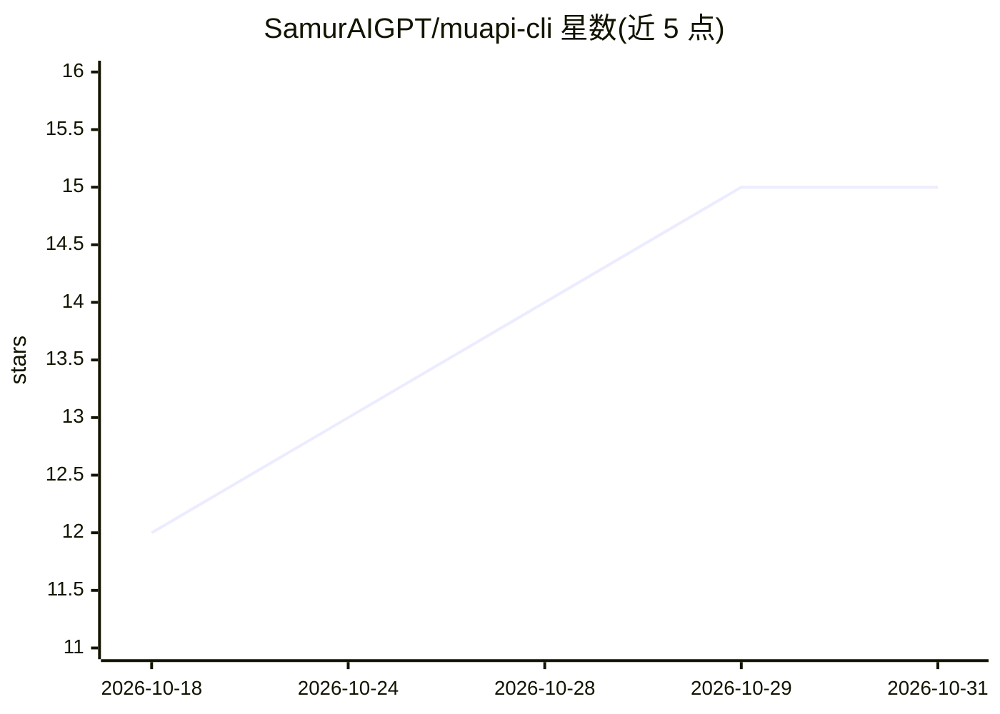

# SamurAIGPT/muapi-cli

⭐ 15 · Python · 推送 2026-10-22 · [GitHub](https://github.com/SamurAIGPT/muapi-cli) · [官网](https://muapi.ai?utm_source=github&utm_medium=about&utm_campaign=muapi-cli) · 组织维护

**muapi.ai 官方 CLI：终端生成图像/视频/音频并充当 MCP 服务器**

muapi.ai 的官方命令行客户端：通过账号认证与 API key，在终端调用平台上的多种生成模型，覆盖文生图、图生图、文生视频、图生视频、Suno 音乐、MMAudio 音频、图像增强（放大/去背景/换脸等）与视频编辑（唇形同步/高光提取等）。提供 schema 驱动的 muapi run 通用运行器，从实时 OpenAPI 规范读取任意模型参数；内置 stdio MCP 服务器（19 个工具），可接入 Claude Code、Cursor、Windsurf 等 agent 客户端，另有托管 MCP 端点。npm 安装，生成消耗 Muapi 积分。

## 筛选速览

| 维度 | 判定 | 备注 |
|---|---|---|
| AI 角色 | `ai-native` | 本体是模型或模型工具 |
| 许可风险 | `none` | — |
| 部署形态 | `library` | 以包/库形式分发 |
| 模型依赖 | — | README 未给出锁定关系 |
| 硬件要求 | — | 无带数字的原话,不猜 |
| 安装摩擦 | `low` | 无编译、无系统依赖或容器化 |
| 成熟度 | — | 结构信号不足 |

## 能力要点

- 图像/视频/音频/增强/编辑五类命令加通用 muapi run 运行器
- 内置 MCP 服务器（19 个工具，stdio 与托管 HTTP 两种传输）
- agent-first 设计：--output-json、--jq 过滤、语义化退出码
- 通过实时 OpenAPI 规范自动获取任意模型参数

## 适用场景

- 在终端或脚本中直接生成图像、视频与音频
- 让 Claude Code、Cursor 等 AI agent 通过 MCP 调用生成模型
- 无人干预的 agent 流水线：注册、充值、生成、取结果全命令行完成

## 场景标签

`图像生成` `视频生成` · 领域:内容生成

## 证据(README 行号)

> L5: Official command-line interface for muapi.ai — generate images, videos, and audio directly from your terminal.
> L90: |`muapi image generate <prompt>`|Text-to-image generation|
> L108: |`muapi audio create <prompt>`|Create music with Suno|

## 星数曲线

2026-10-18 12 → 2026-10-31 15（+3）

---
*卡片 v1 · prompt 1.4 · 生成 2026-10-30 · 置信度 high · 依据 README sha `d3266a6a47dd` · [字段定义](../../DATASET.md)*
