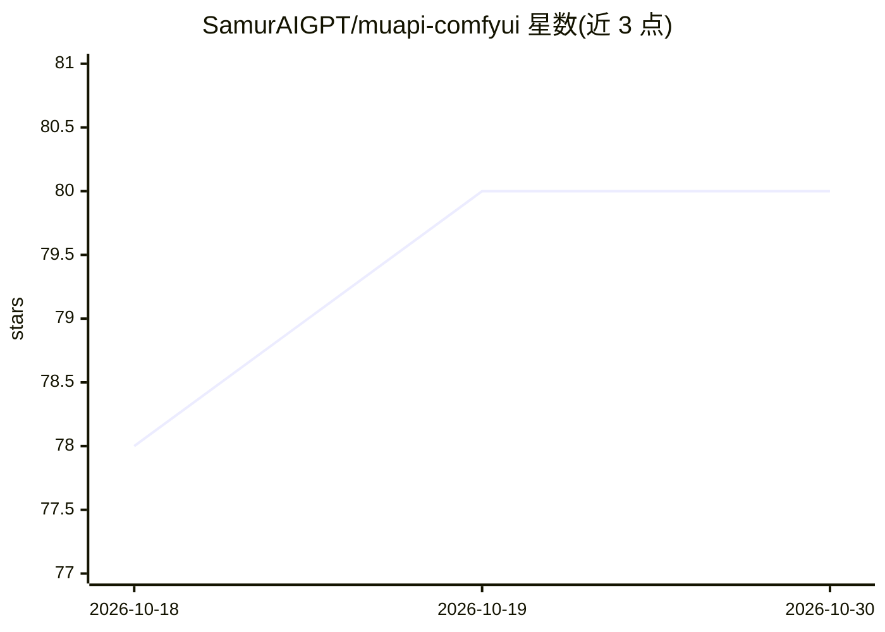

# SamurAIGPT/muapi-comfyui

⭐ 80 · Python · MIT · 推送 2026-10-15 · [GitHub](https://github.com/SamurAIGPT/muapi-comfyui) · [官网](https://muapi.ai/playground/nano-banana) · 组织维护

**ComfyUI 节点包：经 muapi.ai 单一 API 调用 600+ 生成模型**

面向 ComfyUI 用户的自定义节点集，通过 muapi.ai 聚合 API 以单一 key 接入 600+ 文生图、图生图、文生视频、图生视频、图像增强、视频编辑、口型同步与音乐生成模型（Seedance、Kling、Veo3、Flux、GPT-image、Imagen4 等）。含 12 个节点，其中有可调用任意端点并传原始 JSON 的通用节点；Save Video 节点仅接受 cdn.muapi.ai 的 HTTPS URL、限制重定向与保存目录。经 ComfyUI Manager 或 git clone 手动安装，运行需 muapi.ai API key（云端调用，无需本地 GPU）。

## 筛选速览

| 维度 | 判定 | 备注 |
|---|---|---|
| AI 角色 | `ai-native` | 本体是模型或模型工具 |
| 许可风险 | `permissive` | MIT |
| 部署形态 | `library` | 以包/库形式分发 |
| 模型依赖 | — | README 未给出锁定关系 |
| 硬件要求 | — | 无带数字的原话,不猜 |
| 安装摩擦 | `low` | 无编译、无系统依赖或容器化 |
| 成熟度 | — | 结构信号不足 |

## 能力要点

- 12 个节点覆盖文生图/视频、图生视频、增强、口型同步、音乐生成
- 单一 API key 接入 600+ 模型端点
- 通用节点可调用任意端点并传原始 JSON 载荷
- Save Video 安全限制：仅 cdn.muapi.ai HTTPS URL、限定输出子目录

## 适用场景

- 在 ComfyUI 工作流中调用 Kling/Veo3/Seedance 等云端视频模型
- 无本地 GPU 的情况下做图像与视频生成
- 在 ComfyUI 内做图像放大、去背景、口型同步等增强处理

## 场景标签

`图像生成` `视频生成` · 领域:内容生成

## 证据(README 行号)

> L26: MuAPI is a generative media API aggregator giving you access to 600+ cutting-edge models: Seedance 2.0, Kling, Veo3
> L35: |🎬 MuAPI Text-to-Video|🎬 MuAPI|Seedance, Kling, Veo3, Wan, HunyuanVideo, Grok …|

## 星数曲线

2026-10-18 78 → 2026-10-30 80（+2）

---
*卡片 v1 · prompt 1.4 · 生成 2026-10-24 · 置信度 mid · 依据 README sha `6520c4c579fa` · [字段定义](../../DATASET.md)*
