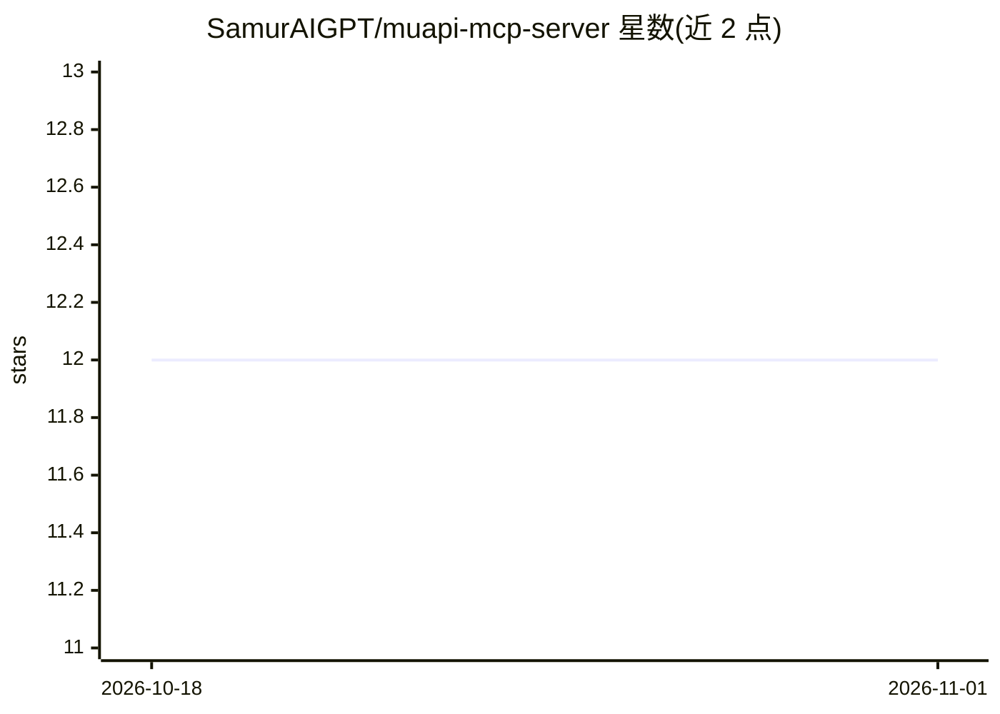

# SamurAIGPT/muapi-mcp-server

⭐ 12 · Python · MIT · 推送 2026-10-01 · [GitHub](https://github.com/SamurAIGPT/muapi-mcp-server) · [官网](https://muapi.ai?utm_source=github&utm_medium=about&utm_campaign=muapi-mcp-server) · 组织维护

**将 muapi.ai 百余个生成模型接入 MCP 客户端的 MCP 服务器**

为 muapi.ai 平台提供的 MCP Server，使 Claude Code、Cursor、Windsurf 等 MCP 客户端可直接调用平台上的 100+ 生成模型，覆盖文生图、图生视频、音乐/音效生成、超分辨率、背景移除、换脸、对口型等工具，并提供模型搜索、异步轮询与账户余额/API key 管理接口。支持托管端点（api.muapi.ai/mcp，仅需 API key）与自托管（Python/FastAPI，克隆仓库后 pip 安装依赖并运行）。自托管需设置 MUAPIAPP_API_KEY 环境变量，生成任务大多异步返回 request_id 后轮询结果。

## 筛选速览

| 维度 | 判定 | 备注 |
|---|---|---|
| AI 角色 | `ai-ecosystem` | LLM/agent 周边工具 |
| 许可风险 | `permissive` | MIT |
| 部署形态 | `library` | 以包/库形式分发 |
| 模型依赖 | — | README 未给出锁定关系 |
| 硬件要求 | — | 无带数字的原话,不猜 |
| 安装摩擦 | `low` | 无编译、无系统依赖或容器化 |
| 成熟度 | — | 结构信号不足 |

## 能力要点

- 提供 100+ 模型的图像/视频/音频生成与编辑 MCP 工具
- 托管与自托管两种部署方式，自托管暴露 REST 端点与 Swagger 文档
- 异步生成返回 request_id，由客户端轮询 muapi_predict_result 获取结果
- 包含账户余额、充值与 API key 管理工具

## 适用场景

- 在 Claude、Cursor 等客户端中直接调用 muapi.ai 的图像/视频/音频生成模型
- 通过对话让助手完成生图、图生视频、音乐创作等任务
- 自托管一个聚合多家生成模型 API 的 MCP 服务

## 场景标签

`图像生成` `视频生成` `图像视频处理` `语音合成` · 领域:内容生成

## 证据(README 行号)

> L5: Connect any MCP-compatible AI assistant to muapi.ai — access 100+ generative AI models (image, video, audio, enhance
> L29: The fastest way: use the hosted MCP server at `https://api.muapi.ai/mcp`. No installation required — just add it to
> L126: Once connected, your AI assistant has access to these tools:

## 星数曲线

2026-10-18 12 → 2026-11-01 12（+0）

---
*卡片 v1 · prompt 1.4 · 生成 2026-11-01 · 置信度 mid · 依据 README sha `f59b01ed9441` · [字段定义](../../DATASET.md)*
