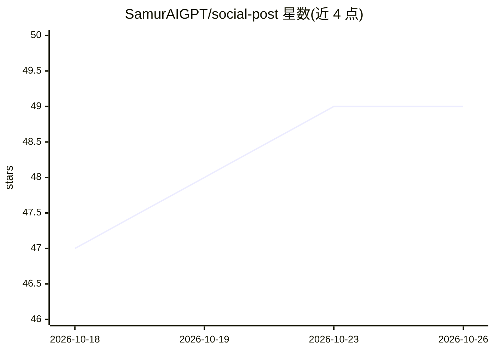

# SamurAIGPT/social-post

⭐ 49 · JavaScript · 推送 2026-07-27 · [GitHub](https://github.com/SamurAIGPT/social-post) · 个人维护

**自托管的 AI 社媒帖子生成 SaaS 模板（Next.js）**

基于 Next.js 14 (App Router)、Prisma、PostgreSQL、NextAuth（Google OAuth）与 Stripe 的可自托管 AI 社媒帖子生成应用：用户输入主题后生成 LinkedIn、Twitter/X、Instagram、Facebook、Reddit、LINE 的平台风格帖子，支持多语气、语言与字数设置，配平台拟真预览卡片、一键唤起发布编辑器与历史存档。AI 生成经 MuAPI（any-llm）完成，按 4 积分/条计费并通过 Stripe 售卖积分包。提供 Vercel 一键部署与本地开发流程，需配置数据库、OAuth、Stripe 与 MuAPI 密钥。

## 筛选速览

| 维度 | 判定 | 备注 |
|---|---|---|
| AI 角色 | `ai-native` | 本体是模型或模型工具 |
| 许可风险 | `none` | — |
| 部署形态 | `library` | 以包/库形式分发 |
| 模型依赖 | — | README 未给出锁定关系 |
| 硬件要求 | — | 无带数字的原话,不猜 |
| 安装摩擦 | `low` | 无编译、无系统依赖或容器化 |
| 成熟度 | — | 结构信号不足 |

## 能力要点

- 六大平台的拟真预览卡片与发布意图（剪贴板复制/直发编辑器）
- 多语气、语言翻译、字数约束与表情/话题标签开关
- Stripe 积分计费（每条 4 积分）与四级套餐购买
- Google OAuth 登录与生成历史持久化存档

## 适用场景

- 社媒运营者批量生成各平台的帖子文案
- 创作者以自托管方式搭建带计费的 AI 写作 SaaS
- 作为生产级 Next.js AI SaaS 启动模板二次开发

## 场景标签

`AI 写作` · 领域:内容生成

## 证据(README 行号)

> L3: > **Generate platform-native social media posts for LinkedIn, Twitter/X, Instagram, Facebook, Reddit, and LINE in se
> L34: - **Kinetic Studio Panel** — Input topics in an expanding textarea, select platforms, tones, and toggle advanced se

## 星数曲线

2026-10-18 47 → 2026-10-26 49（+2）

---
*卡片 v1 · prompt 1.4 · 生成 2026-10-24 · 置信度 high · 依据 README sha `afcd76512b4a` · [字段定义](../../DATASET.md)*
