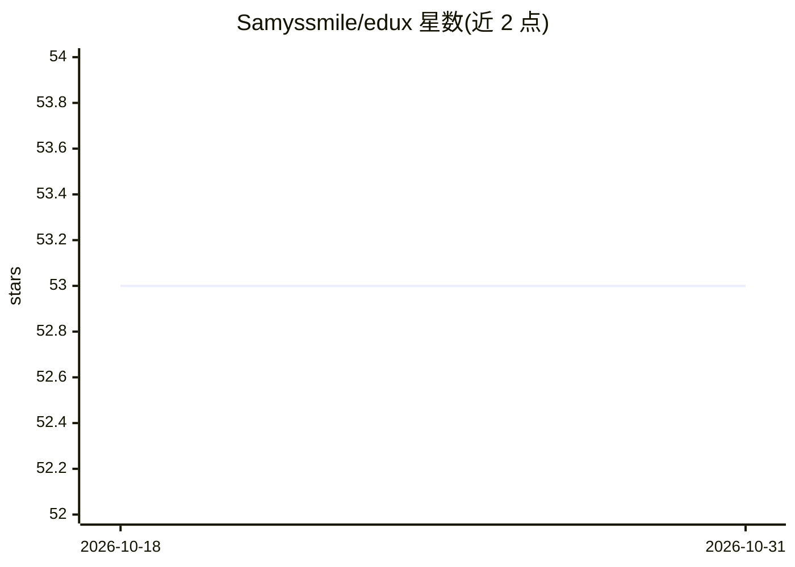

# Samyssmile/edux

⭐ 53 · Java · Apache-2.0 · 推送 2026-08-27 · [GitHub](https://github.com/Samyssmile/edux) · [官网](https://samyssmile.github.io/edux/) · 个人维护

**面向教学场景的 Java 机器学习库，含多种算法与图像增强**

以 Java 编写的机器学习库，提供多层感知机（MLP）、K 近邻、决策树、支持向量机、随机森林等算法，可用于回归与分类问题。另提供图像增强功能（缩放、色彩均衡化、单色加噪等），通过 AugmentationBuilder 链式配置。MLP 可通过 NetworkBuilder 逐层搭建、训练、保存与加载模型；README 附 MNIST 教程与在统一数据集上运行各算法的对比测试。GPU 加速（CUDA 11.8）为预览特性，以 Gradle/Maven 依赖形式引入。

## 筛选速览

| 维度 | 判定 | 备注 |
|---|---|---|
| AI 角色 | `ai-native` | 本体是模型或模型工具 |
| 许可风险 | `permissive` | Apache-2.0 |
| 部署形态 | `None` |  |
| 模型依赖 | — | README 未给出锁定关系 |
| 硬件要求 | — | 无带数字的原话,不猜 |
| 安装摩擦 | `medium` | 含编译或系统依赖之一 |
| 成熟度 | `idea` | |

## 能力要点

- 提供 MLP、KNN、决策树、SVM、随机森林等算法
- 图像增强序列（Resize/色彩均衡化/单色加噪）通过 Builder 配置
- 模型可保存为 model.edux 并继续训练
- Nvidia GPU 加速（CUDA 11.8）为预览特性

## 适用场景

- 在 Java 项目中用少量代码完成分类或回归任务
- 教学与学习场景下使用多种经典机器学习算法
- 训练前对图像数据集做增强预处理

## 场景标签

`图像视频处理` · 领域:感知与多模态

## 证据(README 行号)

> L6: EDUX is a user-friendly library for solving problems with a machine learning approach.
> L12: - **Multilayer Perceptron (Neural Network):** Suitable for regression and classification problems, MLPs can approxi
> L72: The main goal of this project is to create a user-friendly library for solving problems using a machine learning

## 星数曲线

2026-10-18 53 → 2026-10-31 53（+0）

---
*卡片 v1 · prompt 1.4 · 生成 2026-10-24 · 置信度 high · 依据 README sha `681dfa7db27e` · [字段定义](../../DATASET.md)*
