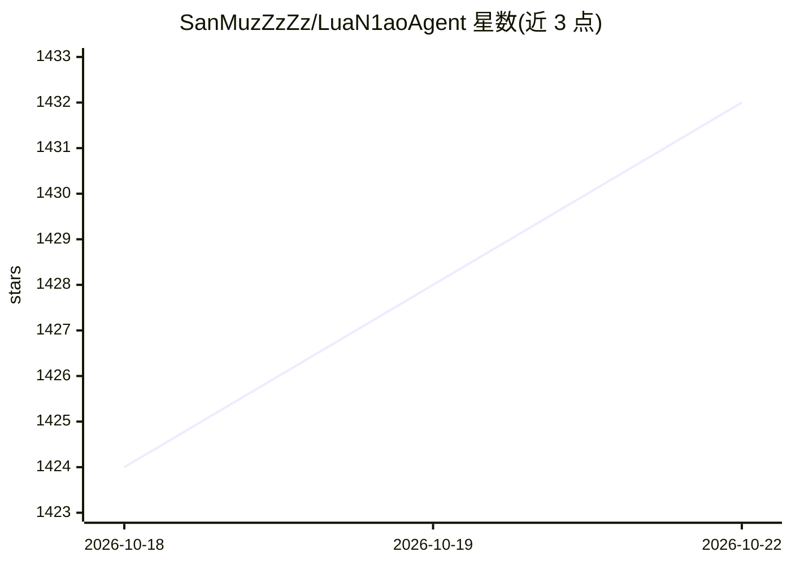

# SanMuzZzZz/LuaN1aoAgent

⭐ 1,432 · TypeScript · AGPL-3.0 · 推送 2026-09-15 · [GitHub](https://github.com/SanMuzZzZz/LuaN1aoAgent) · 个人维护 · 中文 README

**面向授权安全测试的认知驱动自主 Agent（TypeScript 重写版）**

基于 TypeScript 与 Pi SDK 构建的自主渗透测试 Agent，采用 Planner-Executor-Observer 三角色架构：Planner 维护依赖感知的任务图，Executor 在隔离沙箱（Docker/Seatbelt/Bubblewrap）中执行工具循环，Observer 以 Supervisor/Projector 双模式做控制决策与异步图更新。核心机制包括证据支撑的因果推理图（Vulnerability/Exploit 节点强制证据引用）、内容寻址工件、浏览器渲染与 CVE/NVD 检索工具。限制：v2 基准结果待冻结版本重跑后才发布；仅供授权安全研究使用。

## 筛选速览

| 维度 | 判定 | 备注 |
|---|---|---|
| AI 角色 | `ai-native` | 本体是模型或模型工具 |
| 许可风险 | `dual` | AGPL-3.0 |
| 部署形态 | `library` | 以包/库形式分发 |
| 模型依赖 | — | README 未给出锁定关系 |
| 硬件要求 | — | 无带数字的原话,不猜 |
| 安装摩擦 | `low` | 无编译、无系统依赖或容器化 |
| 成熟度 | — | 结构信号不足 |

## 能力要点

- Planner-Executor-Observer 三角色架构与结构化终止提交工具
- 证据支撑的因果推理图：Evidence→Hypothesis→Vulnerability→Exploit
- Plan-on-Graph 动态任务规划，依赖感知并发调度
- Docker 沙箱隔离 + Gateway 透明代理 + macOS/Linux 原生沙箱回退

## 适用场景

- 在授权目标上开展自动化渗透测试与漏洞研究
- 需要可追溯证据链的安全测试结论审计
- CTF/靶场环境下的自动化 Web 安全工作流

## 场景标签

`网络安全` `多智能体` · 领域:Agent 开发

## 证据(README 行号)

> L3: **Cognitive-Driven Autonomous Security Agent**
> L22: **LuaN1aoAgent v2** is a complete rewrite of LuaN1aoAgent, built on TypeScript and the Pi SDK for autonomous, autho

## 星数曲线

2026-10-18 1,424 → 2026-10-22 1,432（+8）

---
*卡片 v1 · prompt 1.4 · 生成 2026-10-21 · 置信度 mid · 依据 README sha `2043d0a18a97` · [字段定义](../../DATASET.md)*
