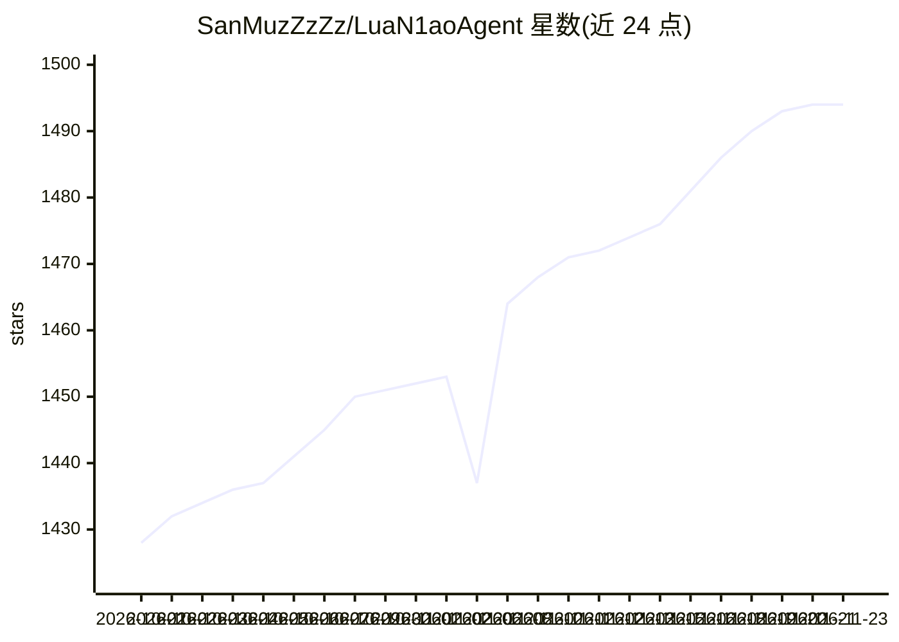

# SanMuzZzZz/LuaN1aoAgent

⭐ 1,494 · TypeScript · AGPL-3.0 · 推送 2026-11-18 · [GitHub](https://github.com/SanMuzZzZz/LuaN1aoAgent) · 个人维护 · 中文 README

**面向授权安全研究的自主渗透测试 AI Agent**

基于 TypeScript 与 Pi SDK 重写的自主安全测试 Agent，采用 Planner-Executor-Observer 三角色运行时：Planner 维护依赖型任务图做动态规划，Executor 在隔离沙箱内选择工具循环执行任务，Observer 以 Supervisor（控制决策）与 Projector（异步图更新）两种模式运行。系统以证据为核心：确认的漏洞与成功利用节点必须附带证据引用，结论可回溯到持久化事件、工件与图节点。要求 Node.js 25+，支持 Docker 沙箱隔离及 macOS Seatbelt、Linux Bubblewrap 等备选方案。

## 筛选速览

| 维度 | 判定 | 备注 |
|---|---|---|
| AI 角色 | `ai-native` | 本体是模型或模型工具 |
| 许可风险 | `dual` | AGPL-3.0 |
| 部署形态 | `library` | 以包/库形式分发 |
| 模型依赖 | — | README 未给出锁定关系 |
| 硬件要求 | — | 无带数字的原话,不猜 |
| 安装摩擦 | `low` | 无编译、无系统依赖或容器化 |
| 成熟度 | — | 结构信号不足 |

## 能力要点

- Planner-Executor-Observer 三角色运行时，替代共享历史的循环
- 因果图推理：证据→假设→漏洞→利用的显式可溯源链
- Plan-on-Graph 动态任务规划，支持依赖感知并发调度
- Docker/Seatbelt/Bubblewrap 多级沙箱隔离

## 适用场景

- 在授权范围内执行自主渗透测试与漏洞利用验证
- 将侦察、认证、利用等任务按依赖图并行编排
- 审计渗透测试结论的证据链与推理过程
- 通过社区技能集合扩展侦察与利用工作流

## 场景标签

`多智能体` `网络安全` · 领域:Agent 开发

## 证据(README 行号)

> L3: **Cognitive-Driven Autonomous Security Agent**
> L24: **LuaN1aoAgent v2** is a complete rewrite of LuaN1aoAgent, built on TypeScript and the Pi SDK for autonomous, autho
> L30: - **Planner** controls goals, scope, dependencies, task budgets, and graph-level scheduling.

## 星数曲线

2026-10-21 1,428 → 2026-11-23 1,494（+66）

---
*卡片 v1 · prompt 1.4 · 生成 2026-11-23 · 置信度 high · 依据 README sha `0099a95fa120` · [字段定义](../../DATASET.md)*
