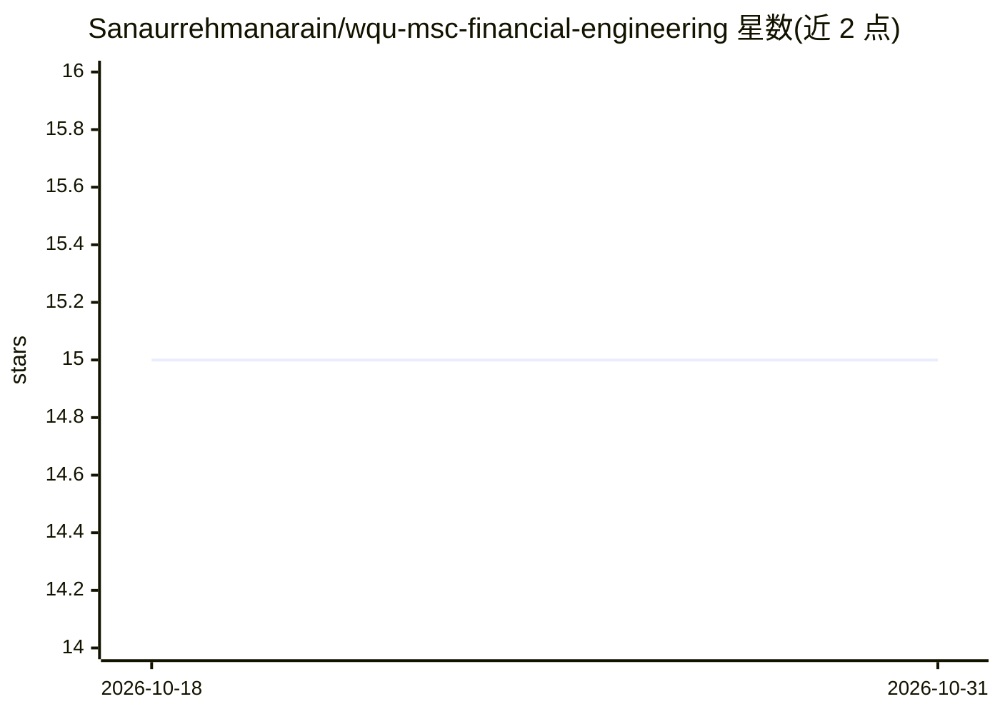

# Sanaurrehmanarain/wqu-msc-financial-engineering

⭐ 15 · Jupyter Notebook · NOASSERTION · 推送 2026-08-19 · [GitHub](https://github.com/Sanaurrehmanarain/wqu-msc-financial-engineering) · [官网](https://www.wqu.edu/) · 个人维护

**金融工程硕士课程作业与项目存档（WorldQuant University）**

个人学术档案仓库，收录作者在 WorldQuant University 金融工程硕士（MScFE）项目的完整课程作业与项目，按课程时间顺序组织为 9 门课程文件夹（金融市场、金融计量、衍生品定价、随机建模、机器学习/深度学习在金融中的应用、组合与风险管理等）。每门课程含 Jupyter Notebook 课件与数据集，以及带代码、数据和报告的应用项目。内容以 Python、Pandas、NumPy、Scikit-Learn、TensorFlow/PyTorch 为工具。采用 CC BY-NC-ND 4.0 许可，明确仅限学习参考，禁止抄袭提交。

## 筛选速览

| 维度 | 判定 | 备注 |
|---|---|---|
| AI 角色 | `ai-knowledge` | 知识聚合/清单类 |
| 许可风险 | `none` | NOASSERTION |
| 部署形态 | `None` |  |
| 模型依赖 | — | README 未给出锁定关系 |
| 硬件要求 | — | 无带数字的原话,不猜 |
| 安装摩擦 | `low` | 无编译、无系统依赖或容器化 |
| 成熟度 | — | 结构信号不足 |

## 能力要点

- 9 门 MScFE 课程的作业、项目与数据集存档
- 按课程时间顺序组织，含 Notebook 与项目报告
- 覆盖 ML/DL 金融时间序列预测与模式识别实现
- 含 CITATION.cff，GitHub 提供 BibTeX/APA 引用格式

## 适用场景

- 查阅量化金融硕士项目的课程内容与项目实例
- 参考机器学习/深度学习在金融场景中的实现思路
- 了解金融工程课程的作业与项目组织方式

## 场景标签

`金融量化` `教程课程` · 领域:学习与行业

## 证据(README 行号)

> L5: This repository contains my complete academic coursework and projects from the **MSc in Financial Engineering (MScFE
> L12: * **Lessons:** Jupyter Notebooks (`.ipynb`) and required datasets for weekly modules.

## 星数曲线

2026-10-18 15 → 2026-10-31 15（+0）

---
*卡片 v1 · prompt 1.4 · 生成 2026-10-30 · 置信度 high · 依据 README sha `46807827b84c` · [字段定义](../../DATASET.md)*
