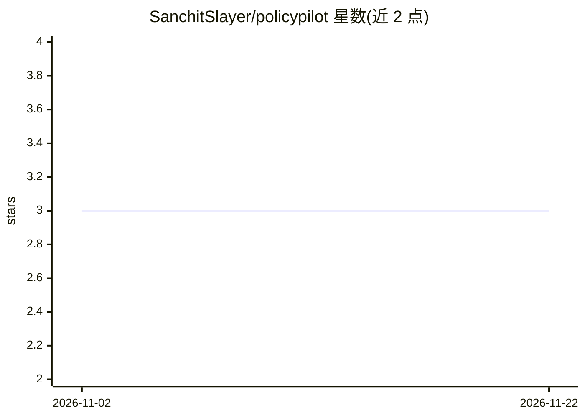

# SanchitSlayer/policypilot

⭐ 3 · Python · 推送 2026-10-24 · [GitHub](https://github.com/SanchitSlayer/policypilot) · 个人维护

**合规团队的 RAG 问答与合同审查工具，带页级引用**

PolicyPilot 是面向合规、运营与法务团队的 AI 合规助手：对上传的政策 PDF 做检索问答，答案逐 token 流式输出并内联页级引用标记，文档未覆盖时明确拒绝回答；内置工具调用式合同审查 agent，逐条标注条款合规状态并导出 JSON/Markdown；每次 LLM 与 embedding 调用记录 token、延迟与估算成本并出仪表盘。技术栈为 FastAPI、PostgreSQL+pgvector、MongoDB、Next.js；Docker Compose 一键启动，离线 Fake provider 无需 API key 即可试用。仓库目前未声明开源许可。

## 筛选速览

| 维度 | 判定 | 备注 |
|---|---|---|
| AI 角色 | `ai-native` | 本体是模型或模型工具 |
| 许可风险 | `none` | — |
| 部署形态 | `None` |  |
| 模型依赖 | locked-api |  |
| 硬件要求 | — | 无带数字的原话,不猜 |
| 安装摩擦 | `low` | 无编译、无系统依赖或容器化 |
| 成熟度 | — | 结构信号不足 |

## 能力要点

- RAG 回答带 [n] 页级引用标记，不支持的引用被剔除
- 工具调用合同审查 agent，逐条款输出合规/不合规/需复核及政策出处
- OpenAI/Claude/Gemini 三 provider 一个接口切换，另含离线 Fake provider
- 全量调用日志仪表盘：token、p50/p95 延迟、按 provider 成本

## 适用场景

- 上传内部 SOP 与监管文件后对话式查询，引用精确到页
- 将供应商合同逐条对照政策生成可审计的合规清单
- 追踪每次 LLM 调用的延迟与成本

## 场景标签

`RAG` `文档问答` `LLM 可观测性` · 领域:评测与运维

## 证据(README 行号)

> L3: **An AI compliance copilot that answers questions from your policy PDFs with page-level citations, reviews contracts
> L17: Compliance, operations and legal teams spend hours searching regulations (KYC directions, lending guidelines, inter
> L22: - **Three LLM providers, one switch**: OpenAI, Anthropic Claude or Google Gemini per request, behind one provider i

## 星数曲线

2026-11-02 3 → 2026-11-22 3（+0）

---
*卡片 v1 · prompt 1.4 · 生成 2026-11-22 · 置信度 high · 依据 README sha `3a43a6d869a5` · [字段定义](../../DATASET.md)*
