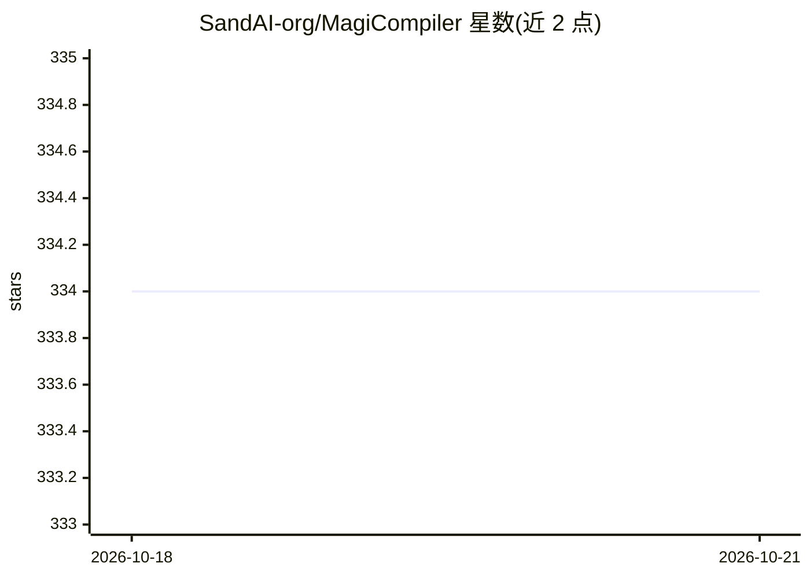

# SandAI-org/MagiCompiler

⭐ 334 · Python · Apache-2.0 · 推送 2026-10-21 · [GitHub](https://github.com/SandAI-org/MagiCompiler) · 组织维护

**面向大模型训练与多模态推理的编译器加速框架**

构建于 torch.compile 之上的编译与运行时增强框架，面向大规模 Transformer 类架构，通过全图捕获、FSDP 感知的逐层编译、选择性异步卸载与启发式激活重计算，在少量代码改动下同时加速训练与多模态推理负载。以两个装饰器形式接入，提供 magi_depyf 内省工具转储编译时间线与子图供调试。要求 Python 3.12+、PyTorch 2.9.x/2.12.x 与 CUDA Toolkit，推荐从预构建 Docker 镜像起步。Apache 2.0 许可，由 SandAI 维护，处于快速开发阶段。

## 筛选速览

| 维度 | 判定 | 备注 |
|---|---|---|
| AI 角色 | `ai-ecosystem` | LLM/agent 周边工具 |
| 许可风险 | `permissive` | Apache-2.0 |
| 部署形态 | `self-host` | docker 或自建部署 |
| 模型依赖 | — | README 未给出锁定关系 |
| 硬件要求 | — | 无带数字的原话,不猜 |
| 安装摩擦 | `low` | 无编译、无系统依赖或容器化 |
| 成熟度 | — | 结构信号不足 |

## 能力要点

- 推理全图捕获与训练 FSDP 感知逐层编译
- @magi_compile / @magi_register_custom_op 两个装饰器即插即用接入
- 选择性异步卸载与启发式激活重计算降低峰值显存
- magi_depyf 内省工具转储编译过程供调试

## 适用场景

- 为视频生成等 Transformer 模型推理加速且少改代码
- 大模型 FSDP 分布式训练中做跨算子融合加速
- 显存受限消费级 GPU 上通过卸载运行大模型

## 场景标签

`模型训练` `推理引擎` · 领域:训练与推理

## 证据(README 行号)

> L29: MagiCompiler is an advanced compiler and runtime augmentation framework built on top of `torch.compile`. Designed s
> L31: By stepping beyond traditional local operator optimization, MagiCompiler introduces system-level optimizations, sea

## 星数曲线

2026-10-18 334 → 2026-10-21 334（+0）

---
*卡片 v1 · prompt 1.4 · 生成 2026-10-22 · 置信度 high · 依据 README sha `551a0059faa9` · [字段定义](../../DATASET.md)*
