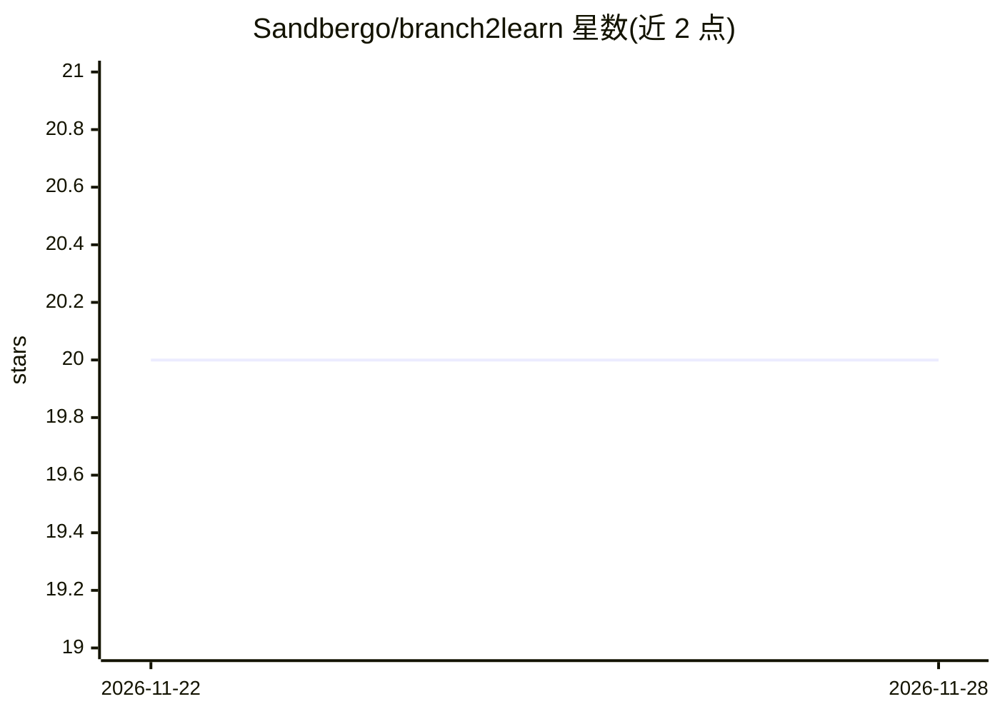

# Sandbergo/branch2learn

⭐ 20 · Python · MIT · 推送 2026-11-21 · [GitHub](https://github.com/Sandbergo/branch2learn) · 个人维护

**用图卷积网络学习 MILP 分支定界分支变量的论文代码**

硕士论文《Ablating a Graph convolutional Network for Branching in Mixed-Integer Linear Programming》的源码：使用图卷积神经网络与多层感知机，在 Ecole 框架中学习混合整数线性规划分支定界算法的最优分支变量。实现思路源自 Gasse 等人 2019 年与 Gupta 等人 2020 年两篇论文的变体。工作流覆盖数据生成、模型训练、性能测试与策略评估，可用单个 bash 脚本复现全部实验，安装说明在独立的 INSTALL.md 中。

## 筛选速览

| 维度 | 判定 | 备注 |
|---|---|---|
| AI 角色 | `ai-native` | 本体是模型或模型工具 |
| 许可风险 | `permissive` | MIT |
| 部署形态 | `None` |  |
| 模型依赖 | — | README 未给出锁定关系 |
| 硬件要求 | — | 无带数字的原话,不猜 |
| 安装摩擦 | `low` | 无编译、无系统依赖或容器化 |
| 成熟度 | — | 结构信号不足 |

## 能力要点

- GCN 与 MLP 两类模型学习分支定界中的分支变量选择
- 基于 Ecole（DS4DM）的 Gym 式组合优化求解器接口
- 数据生成→训练→测试→评估的完整实验流水线
- run.sh 一键复现全部实验

## 适用场景

- 复现论文中的分支策略学习实验
- 在 setcover 等问题上比较学习型分支策略与默认策略
- 作为组合优化与机器学习结合的研究起点

## 场景标签

`模型训练` `科研工具` · 领域:学习与行业

## 证据(README 行号)

> L6: Learning the optimal branching variable in Mixed Integer Linear Programming branch-and-bound algorithms with graph c
> L36: ### Generate Dataset
> L43: python branch2learn/02_train.py -p $PROBLEM -m $MODEL -g $DEVICE

## 星数曲线

2026-11-22 20 → 2026-11-28 20（+0）

---
*卡片 v1 · prompt 1.4 · 生成 2026-11-22 · 置信度 high · 依据 README sha `91f8dcafd89c` · [字段定义](../../DATASET.md)*
