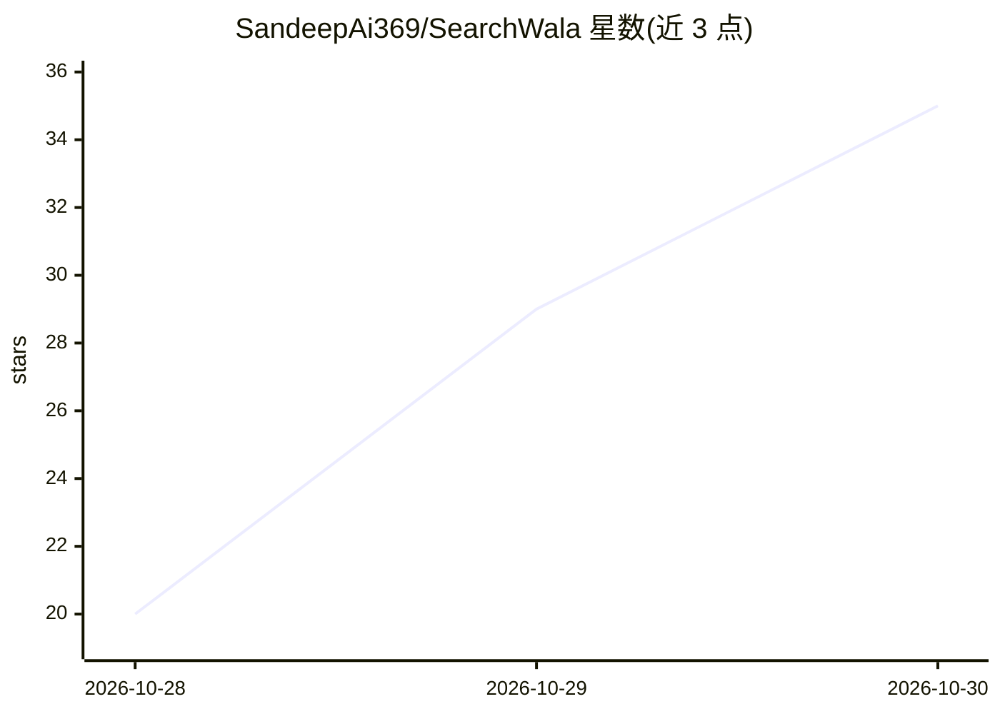

# SandeepAi369/SearchWala

⭐ 35 · Rust · Apache-2.0 · 推送 2026-10-27 · [GitHub](https://github.com/SandeepAi369/SearchWala) · [官网](https://sandeepai369.github.io/SearchWala/) · 个人维护

**本地运行的 Rust 元搜索与带引用 AI 问答引擎**

单个 Rust 二进制在 127.0.0.1 运行的私有元搜索引擎：并行查询 17 个搜索引擎，按独立索引的共识对结果排序，用 trafilatura/Readability 及深度读取器提取全文，可选接入任意 LLM 生成带可点击引用的回答，也可无 LLM 使用（返回排序来源与逐字引用的快速回答）。支持 Fast/Auto/Deep/Study/Academic 五种模式，会话保存于本地 SQLite，无账号无遥测。可从源码编译、下载预编译 Linux 二进制或用 Docker 运行，并提供 HTTP 搜索 API。

## 筛选速览

| 维度 | 判定 | 备注 |
|---|---|---|
| AI 角色 | `ai-native` | 本体是模型或模型工具 |
| 许可风险 | `permissive` | Apache-2.0 |
| 部署形态 | `self-host` | docker 或自建部署 |
| 模型依赖 | local-ok | 支持本地模型 |
| 硬件要求 | — | 无带数字的原话,不猜 |
| 安装摩擦 | `low` | 无编译、无系统依赖或容器化 |
| 成熟度 | — | 结构信号不足 |

## 能力要点

- 17 个引擎并行搜索，按独立索引共识排序结果
- 无 LLM 也可使用：排序来源加逐字引用快速回答
- 引用逐条核验，每个 [n] 链接到模型所见的原始来源
- 会话保存于本地 SQLite，密钥仅存于浏览器

## 适用场景

- 在本机私有化进行带引用的搜索问答
- 做深度研究报告或学术文献综述（OpenAlex/arXiv）
- 通过 HTTP API 从代码中调用搜索与回答

## 场景标签

`科研工具` · 领域:学习与行业

## 证据(README 行号)

> L3: ### A private meta-search and answer engine, in one Rust binary
> L5: Ask a question. SearchWala searches 17 engines at once, reads the pages they
> L6: agree on, and answers with citations you can click, using any LLM or none.
> L133: **Add an AI model (optional):** Settings → choose a provider → paste a key →

## 星数曲线

2026-10-28 20 → 2026-10-30 35（+15）

---
*卡片 v1 · prompt 1.4 · 生成 2026-10-28 · 置信度 mid · 依据 README sha `9ca113f79603` · [字段定义](../../DATASET.md)*
