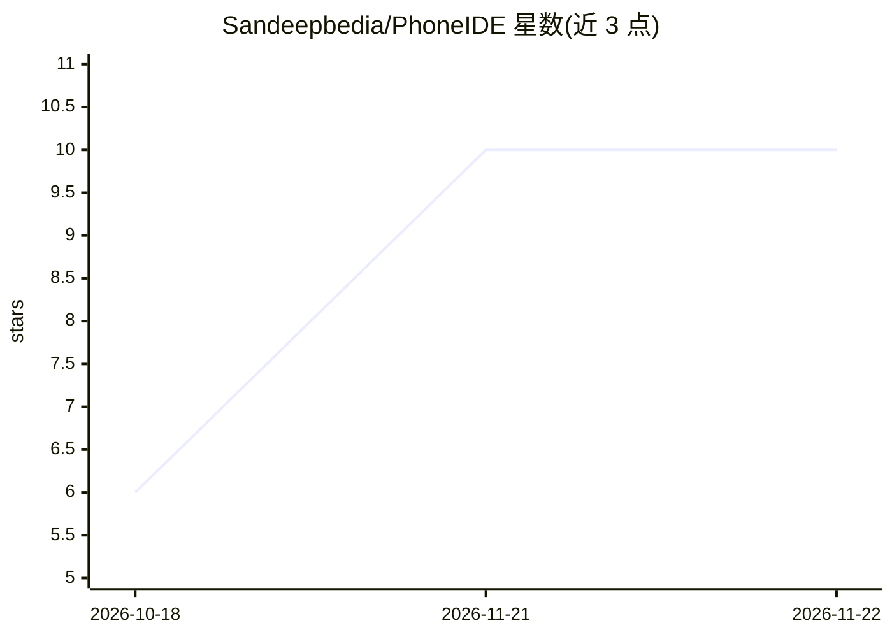

# Sandeepbedia/PhoneIDE

⭐ 10 · 推送 2026-11-06 · [GitHub](https://github.com/Sandeepbedia/PhoneIDE) · [官网](https://t.me/phoneide) · 个人维护

**在手机上运行的完整开发环境：编辑器+构建+终端+AI Agent**

PhoneIDE 是一个完全在手机上运行的开发环境，README 声明其包含代码编辑器、构建系统、终端与 AI Agent 等组件，定位为无需 PC 的移动端开发工具。可见 README 内容较少，仅有项目名称、一句话描述和 Telegram 社区链接，未展示安装方式、支持平台、语言支持范围等细节，具体功能与限制需参考仓库其他文档。

## 筛选速览

| 维度 | 判定 | 备注 |
|---|---|---|
| AI 角色 | `ai-enhanced` | 去掉 AI 部分产品仍成立 |
| 许可风险 | `none` | — |
| 部署形态 | `None` |  |
| 模型依赖 | — | README 未给出锁定关系 |
| 硬件要求 | — | 无带数字的原话,不猜 |
| 安装摩擦 | `low` | 无编译、无系统依赖或容器化 |
| 成熟度 | — | 结构信号不足 |

## 能力要点

- 完全运行在手机上的开发环境
- 包含代码编辑器、构建系统与终端
- 内置 AI Agent 组件

## 适用场景

- 没有 PC 时在手机上编写和构建代码
- 在移动设备上使用 AI 辅助编程

## 场景标签

`编码 Agent` `代码生成` · 领域:编码与开发

## 证据(README 行号)

> L5:  A powerful development environment right in your pocket.

## 星数曲线

2026-10-18 6 → 2026-11-22 10（+4）

---
*卡片 v1 · prompt 1.4 · 生成 2026-11-21 · 置信度 low · 依据 README sha `25baf2172875` · [字段定义](../../DATASET.md)*
