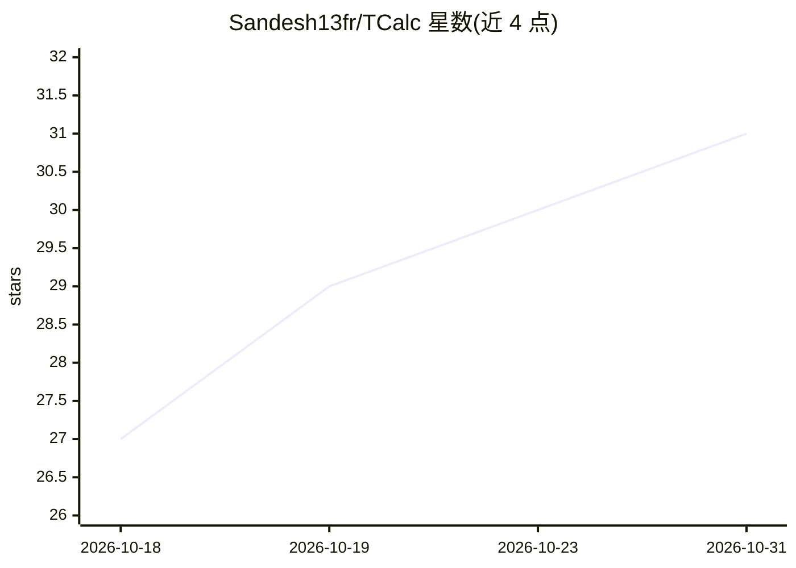

# Sandesh13fr/TCalc

⭐ 31 · TypeScript · MIT · 推送 2026-10-14 · [GitHub](https://github.com/Sandesh13fr/TCalc) · [官网](https://tcalc.younix.xyz/) · 个人维护

**本地工作区 token 计算与模型推荐工具，面向编码 agent**

扫描本地代码库，按文件/文件夹/语言估算 token，输出最省、均衡与高置信三档模型推荐（含上下文适配与成本估计），并生成预算内的 repo map、目标感知的 agent 规则文件与 MCP 配置。提供 VS Code 扩展（Marketplace/Open VSX/VSIX）、CLI、JetBrains 插件 MVP 与本地 stdio MCP 服务器（实验性）。全程本地运行，无遥测、无云端调用、不上传源码。模型目录保持厂商中立。

## 筛选速览

| 维度 | 判定 | 备注 |
|---|---|---|
| AI 角色 | `ai-ecosystem` | LLM/agent 周边工具 |
| 许可风险 | `permissive` | MIT |
| 部署形态 | `library` | 以包/库形式分发 |
| 模型依赖 | — | README 未给出锁定关系 |
| 硬件要求 | — | 无带数字的原话,不猜 |
| 安装摩擦 | `low` | 无编译、无系统依赖或容器化 |
| 成熟度 | `idea` | |

## 能力要点

- 工作区 token 估算与三档模型推荐（上下文适配+成本估计）
- 预算内 repo map 与目标感知的 AGENTS.md 规则生成
- stdio MCP 服务器（实验性 MVP）与多种编码 agent 客户端集成
- 本地优先：无遥测、无云调用、不上传源码

## 适用场景

- 扫描代码库确认上下文被哪些文件占用
- 为当前任务挑选够用的模型并估算成本
- 为 Cursor/Claude Code 等编码 agent 生成上下文与规则配置

## 场景标签

 · 领域:开发者工具/LLM 生态

## 证据(README 行号)

> L1: TCalc measures local workspace tokens and turns them into model recommendations and agent-ready context
> L35: |**03**|**What should the agent read?**|Budgeted repo maps, goal-aware agent rules, reports, and ready-to-use MCP c
> L70: TCalc can expose the same scan, recommendation, repo-map, rules, and report capabilities over stdio MCP. It also ge

## 星数曲线

2026-10-18 27 → 2026-10-31 31（+4）

---
*卡片 v1 · prompt 1.4 · 生成 2026-10-26 · 置信度 high · 依据 README sha `727c53f0217c` · [字段定义](../../DATASET.md)*
