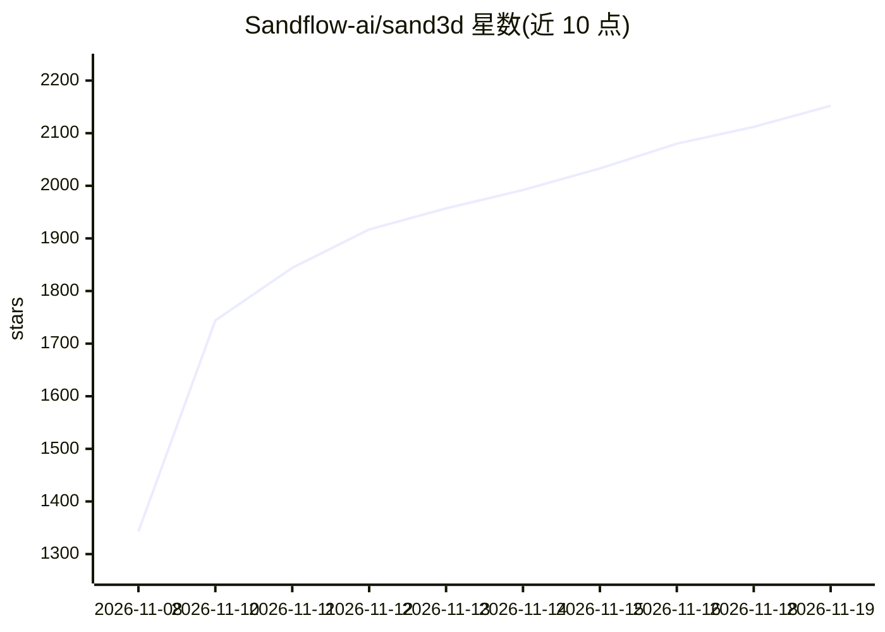

# Sandflow-ai/sand3d

⭐ 2,152 · HTML · Apache-2.0 · 推送 2026-11-18 · [GitHub](https://github.com/Sandflow-ai/sand3d) · [官网](https://sandflow.ai/sand3d/) · 组织维护

**面向 LLM 的 Python 3D 建模库，基于 bpy 生成 3D 对象程序**

构建于 Blender bpy 之上的 Python 库，将 3D 对象表达为短程序：轮廓、实体、编辑、坐标系、关节与装配，部件按名称而非坐标引用，同程序构建的网格逐位一致。整个 API 约 3,600 token 可放入 system prompt，配合 llms.txt 供模型生成模型代码。支持导出 GLB/URDF/USD/IFC/OBJ/STL，另在 Hugging Face 发布五个 CC BY 4.0 程序数据集。限制：bpy 在 Python 3.12 与 Intel Mac（5.2 起）无 wheel；IFC 导出不带关节且 GlobalId 不适合跨导出追踪部件。

## 筛选速览

| 维度 | 判定 | 备注 |
|---|---|---|
| AI 角色 | `ai-ecosystem` | LLM/agent 周边工具 |
| 许可风险 | `permissive` | Apache-2.0 |
| 部署形态 | `library` | 以包/库形式分发 |
| 模型依赖 | — | README 未给出锁定关系 |
| 硬件要求 | — | 无带数字的原话,不猜 |
| 安装摩擦 | `low` | 无编译、无系统依赖或容器化 |
| 成熟度 | — | 结构信号不足 |

## 能力要点

- 部件 token 量比 Blender Python/CadQuery/FeatureScript 少 2-6 倍
- 整个 API 约 3,600 token，可放入 system prompt 供 LLM 使用
- 一次调用导出 GLB/URDF/USD/IFC/OBJ/STL 六种格式
- 同名程序确定性构建相同网格；提供五个 Hugging Face 数据集

## 适用场景

- 让 LLM 直接生成可读、可编辑的 3D 模型程序
- 为仿真（ROS/MuJoCo/Isaac）与 BIM（Revit/ArchiCAD）流水线导出资产
- 以程序形式重建和复用 Objaverse、CAD 等来源的 3D 对象

## 场景标签

`代码生成` · 领域:编码与开发

## 证据(README 行号)

> L5: **3D modeling in Python, built for LLMs.**
> L30: - **The whole API fits in a prompt**, about 3,600 tokens (the API).

## 星数曲线

2026-11-08 1,343 → 2026-11-19 2,152（+809）

---
*卡片 v1 · prompt 1.4 · 生成 2026-11-17 · 置信度 high · 依据 README sha `52fdd70176d3` · [字段定义](../../DATASET.md)*
