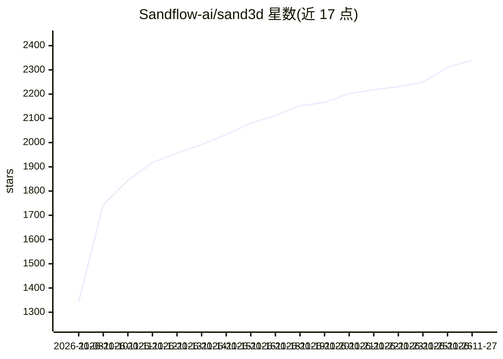

# Sandflow-ai/sand3d

⭐ 2,340 · HTML · Apache-2.0 · 推送 2026-11-26 · [GitHub](https://github.com/Sandflow-ai/sand3d) · [官网](https://sandflow.ai/sand3d/) · 组织维护

**面向 LLM 的 Python 3D 建模库：用短程序描述物体**

基于 Blender bpy 的 Python 库，将 3D 物体写成简短程序：轮廓、实体、编辑、关节与装配，以及自然形态（草木、水体、岩石）。与 Blender Python 等写法相比，每部件 token 数更少；部件按命名访问，避免手工计算坐标；同一程序在相同环境下确定性重建网格。一次调用导出 GLB、URDF、USD、IFC、OBJ、STL，并在 Hugging Face 提供六个 CC BY 4.0 数据集。Python 3.11/3.13，不支持 3.12 与 5.2 起的 Intel Mac。

## 筛选速览

| 维度 | 判定 | 备注 |
|---|---|---|
| AI 角色 | `ai-enhanced` | 去掉 AI 部分产品仍成立 |
| 许可风险 | `permissive` | Apache-2.0 |
| 部署形态 | `library` | 以包/库形式分发 |
| 模型依赖 | — | README 未给出锁定关系 |
| 硬件要求 | — | 无带数字的原话,不猜 |
| 安装摩擦 | `low` | 无编译、无系统依赖或容器化 |
| 成熟度 | — | 结构信号不足 |

## 能力要点

- 以 flat s3d.<verb> API 提供 70+ 动词：轮廓、实体、编辑、关节、装配等
- 一次调用导出 GLB/URDF/USDA/IFC/OBJ/STL 六种格式
- 每个部件 2-6× 更少 token，部件按命名访问，程序确定性重建
- Hugging Face 提供六个 sand3d 程序数据集（CC BY 4.0）

## 适用场景

- 让 LLM 以少量 token 生成可读、可复现的 3D 物体程序
- 为 ROS/仿真管线导出带关节的 URDF 或 USD 资产
- 将零件程序导出 IFC 供 BIM 工作流（Revit/ArchiCAD）使用

## 场景标签

 · 领域:3D 建模/程序化生成

## 证据(README 行号)

> L5: **3D modeling in Python, built for LLMs.**
> L7: sand3d is a Python library for writing 3D objects as short programs: profiles, solids,
> L112: Put docs/api.md in the system prompt: the rules of the vocabulary, every

## 星数曲线

2026-11-08 1,343 → 2026-11-27 2,340（+997）

---
*卡片 v1 · prompt 1.4 · 生成 2026-11-26 · 置信度 mid · 依据 README sha `495fca99311c` · [字段定义](../../DATASET.md)*
