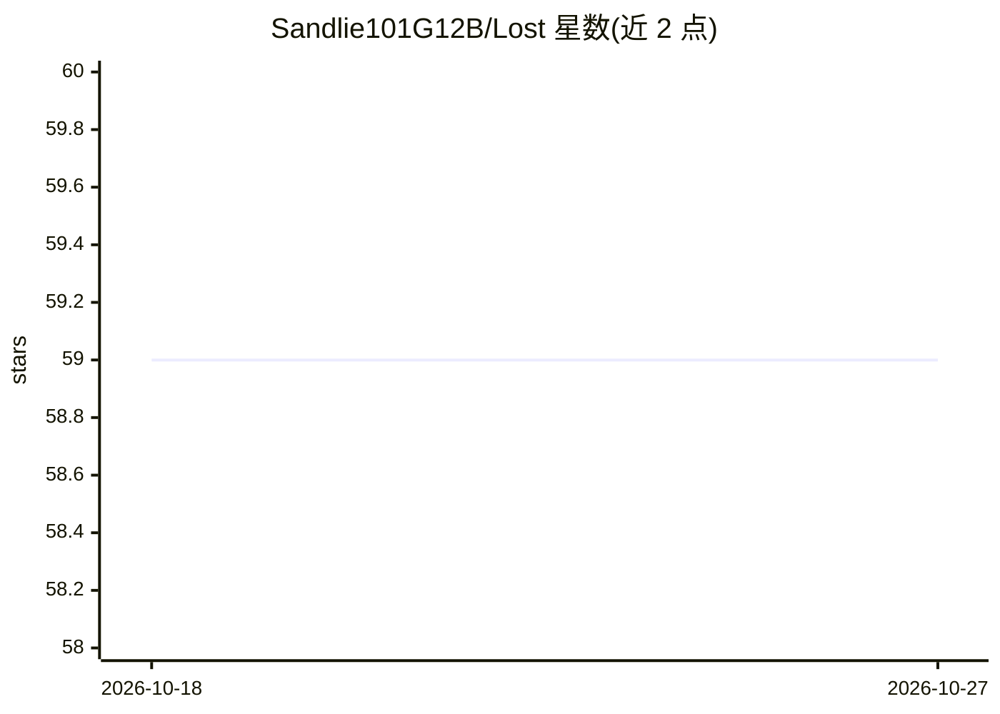

# Sandlie101G12B/Lost

⭐ 59 · Kotlin · GPL-3.0 · 推送 2026-04-13 · [GitHub](https://github.com/Sandlie101G12B/Lost) · 个人维护

**Android 本地音乐播放器：离线播放、自动抓取歌词与元数据**

面向 Android 用户的本地音乐播放器（GPLv3），主打完全离线可用、可选联网增强。功能包括自动下载歌词与音乐元数据、标签编辑器、智能随机播放、最近播放/最常播放/播放历史等智能播放列表、播放列表创建编辑导入、三套主题与强调色自定义。通过 GitHub Releases 与 F-Droid 分发。明确声明不支持从互联网下载或流式播放音乐。README 未描述 AI 相关实现细节，仅仓库标签含 ai。

## 筛选速览

| 维度 | 判定 | 备注 |
|---|---|---|
| AI 角色 | `ai-enhanced` | 去掉 AI 部分产品仍成立 |
| 许可风险 | `viral` | GPL-3.0 |
| 部署形态 | `None` |  |
| 模型依赖 | — | README 未给出锁定关系 |
| 硬件要求 | — | 无带数字的原话,不猜 |
| 安装摩擦 | `low` | 无编译、无系统依赖或容器化 |
| 成熟度 | — | 结构信号不足 |

## 能力要点

- 完全离线可用，可选联网增强
- 自动下载歌词与音乐元数据
- 标签编辑器与智能播放列表（最近/最常/历史）
- 三套主题与强调色自定义

## 适用场景

- 在 Android 上离线播放本地音乐库
- 自动补全歌曲歌词和元数据信息
- 按播放习惯生成智能播放列表

## 场景标签

 · 领域:媒体播放/移动应用

## 证据(README 行号)

> L60: > **Note:** Lost is a local music player.
> L16: - Automatically downloads lyrics and metadata

## 星数曲线

2026-10-18 59 → 2026-10-27 59（+0）

---
*卡片 v1 · prompt 1.4 · 生成 2026-10-24 · 置信度 low · 依据 README sha `07997a1d87d5` · [字段定义](../../DATASET.md)*
