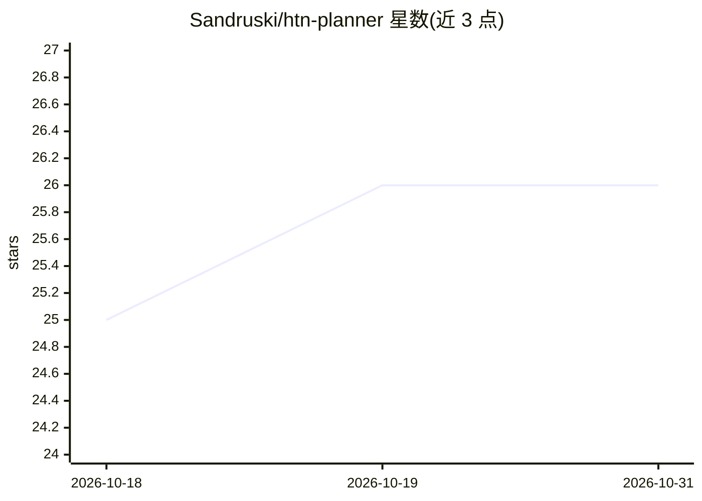

# Sandruski/htn-planner

⭐ 26 · C++ · MIT · 推送 2026-08-29 · [GitHub](https://github.com/Sandruski/htn-planner) · 个人维护

**C++ 分层任务网络规划库，解释自定义领域语言生成计划**

用 C++ 实现的 HTN 规划器库，解释自定义领域语言：世界状态文件定义事实，领域文件定义常量、公理与方法，规划器从顶层复合任务经 DFS 与回溯分解为原子任务序列形成计划，架构上支持多线程并行。解决方案含框架库、调试器库、演示应用与单元测试四个工程，演示应用基于 SDL/Dear ImGui 提供解析、分解与计划查看界面。当前为解释器实现无优化，README 声明为进行中项目，计划迁移到编译器。

## 筛选速览

| 维度 | 判定 | 备注 |
|---|---|---|
| AI 角色 | `ai-native` | 本体是模型或模型工具 |
| 许可风险 | `permissive` | MIT |
| 部署形态 | `desktop` | 安装包/桌面程序 |
| 模型依赖 | — | README 未给出锁定关系 |
| 硬件要求 | — | 无带数字的原话,不猜 |
| 安装摩擦 | `low` | 无编译、无系统依赖或容器化 |
| 成熟度 | `idea` | |

## 能力要点

- 自定义领域语言：.worldstate 与 .domain 文件经词法/解析生成可规划对象
- DFS 分解与选择点回tracking 机制，架构支持多线程并行
- 提供 HTNDemo 图形演示应用（解析/分解/活动计划查看）与 HTNTest 单元测试
- 含 HTNDebugger 调试库，可在调试窗口查看分解过程与回溯选择点

## 适用场景

- 为游戏 AI 角色生成行为计划（参考 GameAIPro/Horizon Zero Dawn 等资料）
- 用简单语句脚本化复杂行为，供内容创作者编写领域
- 研究 HTN 分解、回溯与调试机制

## 场景标签

 · 领域:游戏 AI/自动规划

## 证据(README 行号)

> L2: This project is a hierarchical task network (HTN) planner library for AI decision-making. It is implemented in C++ a
> L58: The decomposition process performs a depth-first search (DFS) on the domain graph. The algorithm starts at the top-

## 星数曲线

2026-10-18 25 → 2026-10-31 26（+1）

---
*卡片 v1 · prompt 1.4 · 生成 2026-10-26 · 置信度 high · 依据 README sha `8962ceafbf74` · [字段定义](../../DATASET.md)*
