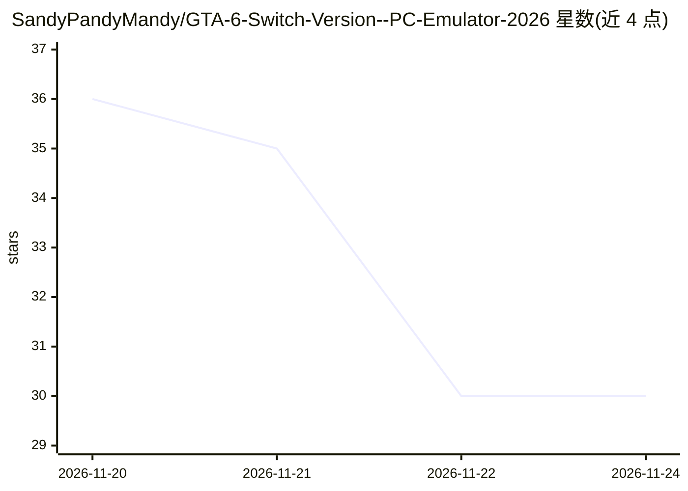

# SandyPandyMandy/GTA-6-Switch-Version--PC-Emulator-2026

⭐ 30 · Rust · Apache-2.0 · 推送 2026-11-21 · [GitHub](https://github.com/SandyPandyMandy/GTA-6-Switch-Version--PC-Emulator-2026) · 个人维护

**面向 Windows 玩家的 GTA VI PC 版安装与优化准备指南**

一个针对尚未正式发售的 GTA VI PC 版的资源页面：提供 Windows 环境准备步骤（系统更新、GPU 驱动更新、存储检查、Rockstar Games Launcher 准备）、图形与 FPS 优化说明、常见安装/性能问题排查条目。官方 PC 系统要求与发售日期尚未公布，README 中的配置表全部标注为未确认。随附的 Windows 安装包据 README 声明不含游戏文件。

## 筛选速览

| 维度 | 判定 | 备注 |
|---|---|---|
| AI 角色 | `ai-knowledge` | 知识聚合/清单类 |
| 许可风险 | `permissive` | Apache-2.0 |
| 部署形态 | `desktop` | 安装包/桌面程序 |
| 模型依赖 | — | README 未给出锁定关系 |
| 硬件要求 | — | 无带数字的原话,不猜 |
| 安装摩擦 | `low` | 无编译、无系统依赖或容器化 |
| 成熟度 | — | 结构信号不足 |

## 能力要点

- Windows 兼容性准备清单（DirectX/驱动/存储/系统更新）
- 图形设置与 FPS 排查条目汇总
- 按驱动厂商（NVIDIA/AMD/Intel）提供官方驱动链接
- 官方 PC 要求未公布，配置表标注未确认

## 适用场景

- 为未来的 GTA VI PC 版提前检查 Windows 环境与驱动
- 排查 PC 游戏中的低帧率、卡顿与显示问题
- 了解 Rockstar Games Launcher 的获取与准备方式

## 场景标签

 · 领域:游戏/桌面工具

## 证据(README 行号)

> L3: ### GTA 6 PC Installation, Setup & Performance Guide
> L5: A dedicated PC installation and configuration resource for Grand Theft Auto VI, covering Windows preparation, graphi
> L30: The GTA VI PC release date and official hardware requirements have not yet been announced.

## 星数曲线

2026-11-20 36 → 2026-11-24 30（-6）

---
*卡片 v1 · prompt 1.4 · 生成 2026-11-22 · 置信度 mid · 依据 README sha `2fe487426686` · [字段定义](../../DATASET.md)*
