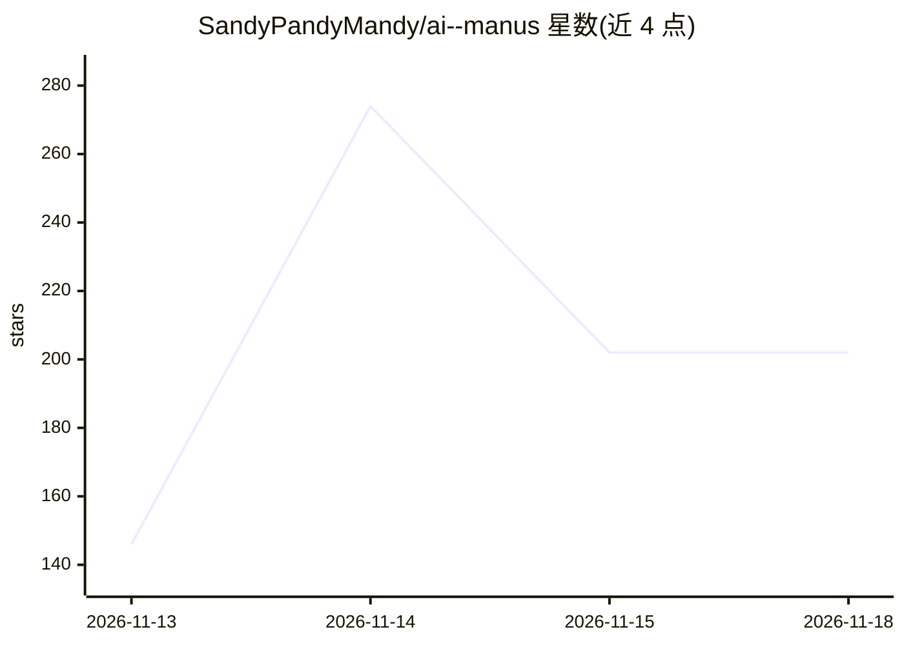

# SandyPandyMandy/ai--manus

⭐ 202 · Apache-2.0 · 推送 2026-11-17 · [GitHub](https://github.com/SandyPandyMandy/ai--manus) · 个人维护

**自主 AI Agent：代用户执行代码并控制浏览器完成任务**

Manus 定位为自主 AI Agent，代替用户编写并执行脚本、控制浏览器（导航页面、填写表单、收集信息），完成多步骤任务。面向学生、远程工作者与轻度办公人群的家庭、学习与小规模工作场景，不定位为企业平台。README 说明其可跨脚本与浏览器组合任务、在会话间复用流程模式，并列出 4GB 内存起步、双核 CPU 的兼容性表格。全文为功能描述与推广性内容，未提供具体安装命令、模型接入方式或代码仓库结构等可验证细节。

## 筛选速览

| 维度 | 判定 | 备注 |
|---|---|---|
| AI 角色 | `ai-native` | 本体是模型或模型工具 |
| 许可风险 | `permissive` | Apache-2.0 |
| 部署形态 | `None` |  |
| 模型依赖 | — | README 未给出锁定关系 |
| 硬件要求 | — | 无带数字的原话,不猜 |
| 安装摩擦 | `low` | 无编译、无系统依赖或容器化 |
| 成熟度 | — | 结构信号不足 |

## 能力要点

- 自主编写并执行代码完成任务
- 浏览器控制：导航网页、填表、收集信息
- 脚本与浏览器动作可在同一任务流中衔接
- 跨会话记忆并复用工作流模式

## 适用场景

- 让 agent 代为收集多网页信息并整理摘要
- 日常重复性小任务（整理研究笔记、检查页面）的自动执行
- 学生组织研究资料与快速运行小脚本

## 场景标签

`浏览器自动化` `编码 Agent` · 领域:效率与自动化

## 证据(README 行号)

> L18: Manus is an autonomous AI agent designed to run code and control a browser on your behalf. Instead of acting like a
> L10: - **Autonomous Code Execution:** Manus AI agent runs code on its own to complete tasks, so you can focus on decisio

## 星数曲线

2026-11-13 146 → 2026-11-18 202（+56）

---
*卡片 v1 · prompt 1.4 · 生成 2026-11-18 · 置信度 mid · 依据 README sha `c06e59c45084` · [字段定义](../../DATASET.md)*
