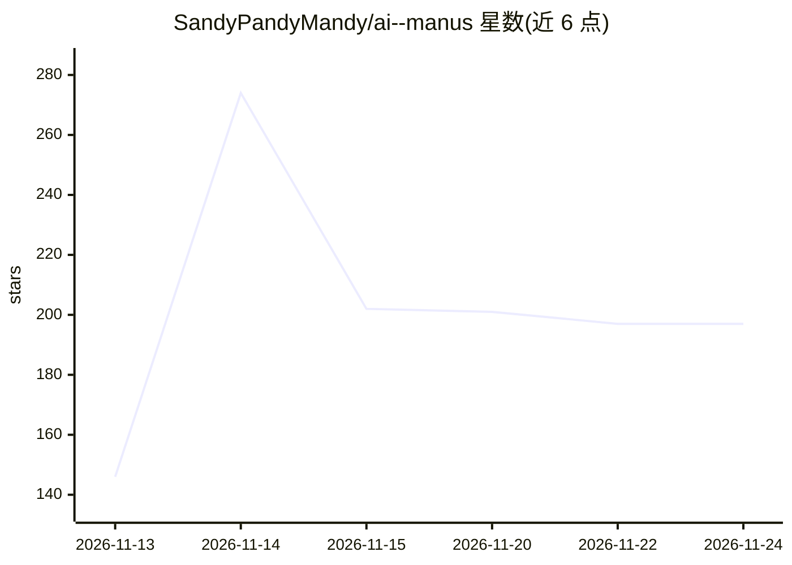

# SandyPandyMandy/ai--manus

⭐ 197 · Apache-2.0 · 推送 2026-11-21 · [GitHub](https://github.com/SandyPandyMandy/ai--manus) · 个人维护

**面向个人用户的自主 AI Agent，代为执行代码与浏览器操作**

自主 AI Agent 系统：接收自然语言指令后自行编写并执行脚本、控制浏览器访问网页、填写表单、抓取信息，并跨会话记住工作流模式，以减少用户重复操作为定位。README 说明其面向学生、远程办公者等个人场景，覆盖学习研究、家庭项目与轻量办公任务；给出最低 4 GB 内存等硬件兼容表与六步使用流程，但未提供具体安装命令或下载链接的细节。

## 筛选速览

| 维度 | 判定 | 备注 |
|---|---|---|
| AI 角色 | `ai-native` | 本体是模型或模型工具 |
| 许可风险 | `permissive` | Apache-2.0 |
| 部署形态 | `None` |  |
| 模型依赖 | — | README 未给出锁定关系 |
| 硬件要求 | — | 无带数字的原话,不猜 |
| 安装摩擦 | `low` | 无编译、无系统依赖或容器化 |
| 成熟度 | — | 结构信号不足 |

## 能力要点

- 自主编写并执行脚本完成任务
- 浏览器控制：导航、填表、收集信息
- 跨会话记住工作流模式并复用
- 面向家庭、学习与轻量办公的小规模场景

## 适用场景

- 让学生整理研究笔记并跑小计算
- 从多个网页自动收集资料
- 自动处理重复性的表单填写与页面检查

## 场景标签

`AI 助手` · 领域:对话与助手

## 证据(README 行号)

> L18: Manus is an autonomous AI agent designed to run code and control a browser on your behalf. Instead of acting like a
> L41: |**Memory (RAM)**|4 GB|8 GB or more for heavy Manus autonomous tasks|

## 星数曲线

2026-11-13 146 → 2026-11-24 197（+51）

---
*卡片 v1 · prompt 1.4 · 生成 2026-11-22 · 置信度 mid · 依据 README sha `aab5d8577d4b` · [字段定义](../../DATASET.md)*
