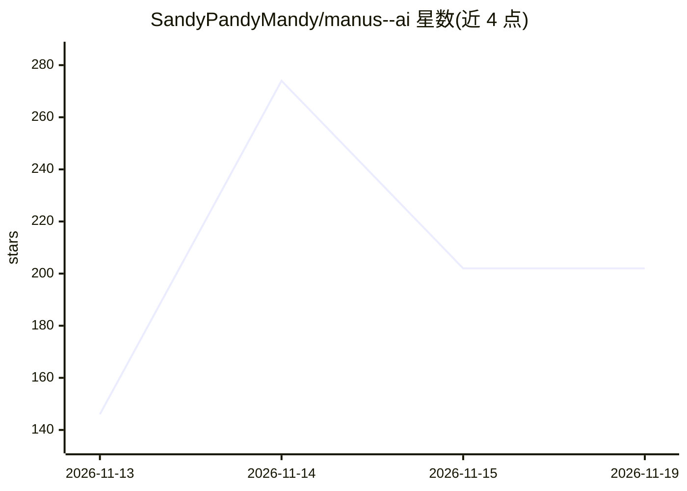

# SandyPandyMandy/manus--ai

⭐ 202 · Apache-2.0 · 推送 2026-11-18 · [GitHub](https://github.com/SandyPandyMandy/manus--ai) · 个人维护

**个人用户的自主 AI Agent：代为执行代码与浏览器操作**

一个通用 AI Agent 系统，面向学生、远程办公者等个人用户，代用户执行多步骤任务：自主编写并运行脚本、控制浏览器导航网页与填写表单、处理日常重复性事务。机制上强调跨会话记忆任务模式、脚本与浏览器操作的串联执行，以及需要确认的任务类型配置。README 未给出具体安装命令、代码仓库结构或技术栈说明，仅提供下载入口与兼容性要求（64 位系统、4 GB 内存起步）。

## 筛选速览

| 维度 | 判定 | 备注 |
|---|---|---|
| AI 角色 | `ai-native` | 本体是模型或模型工具 |
| 许可风险 | `permissive` | Apache-2.0 |
| 部署形态 | `None` |  |
| 模型依赖 | — | README 未给出锁定关系 |
| 硬件要求 | — | 无带数字的原话,不猜 |
| 安装摩擦 | `low` | 无编译、无系统依赖或容器化 |
| 成熟度 | — | 结构信号不足 |

## 能力要点

- 自主代码执行：代用户编写并运行脚本完成任务
- 浏览器控制：导航网页、填写表单、收集信息
- 跨会话一致性：记忆任务模式并重复应用
- 面向家庭/学习/轻量办公场景的小规模任务设计

## 适用场景

- 整理研究笔记、收集参考资料并运行小脚本
- 从多个网页收集信息用于小报告
- 自动化检查页面更新、整理文件等日常琐事

## 场景标签

`AI 助手` `编码 Agent` `浏览器自动化` · 领域:效率与自动化

## 证据(README 行号)

> L1: # Manus - Autonomous AI Agent
> L18: Manus is an autonomous AI agent designed to run code and control a browser on your behalf. Instead of acting like a
> L22: Manus is not a heavy studio suite or a complex enterprise platform. It is a focused helper built for home, study, a

## 星数曲线

2026-11-13 146 → 2026-11-19 202（+56）

---
*卡片 v1 · prompt 1.4 · 生成 2026-11-19 · 置信度 mid · 依据 README sha `c06c32a8c955` · [字段定义](../../DATASET.md)*
