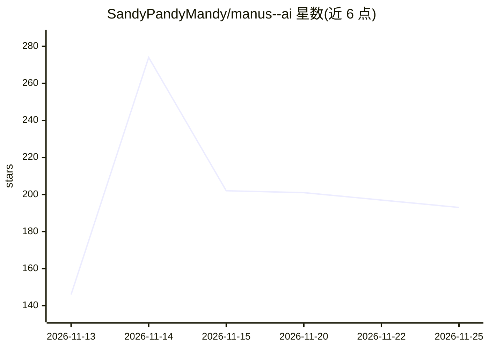

# SandyPandyMandy/manus--ai

⭐ 193 · Apache-2.0 · 推送 2026-11-21 · [GitHub](https://github.com/SandyPandyMandy/manus--ai) · 个人维护

**面向个人用户的沙箱自主 AI Agent：代跑代码与操作浏览器**

README 将 Manus 描述为自主 AI Agent：用户描述任务后，agent 可自行编写并执行脚本、导航网页、填写表单、收集信息，跨多步骤完成任务，并声称跨会话记住工作模式。定位为面向家庭、学习与轻度办公的小规模任务帮手，而非企业级平台。README 提供最低硬件配置表（64 位系统、4 GB 内存）与六步上手流程，但未给出安装命令、源码或依赖说明。

## 筛选速览

| 维度 | 判定 | 备注 |
|---|---|---|
| AI 角色 | `ai-native` | 本体是模型或模型工具 |
| 许可风险 | `permissive` | Apache-2.0 |
| 部署形态 | `None` |  |
| 模型依赖 | — | README 未给出锁定关系 |
| 硬件要求 | — | 无带数字的原话,不猜 |
| 安装摩擦 | `low` | 无编译、无系统依赖或容器化 |
| 成熟度 | — | 结构信号不足 |

## 能力要点

- 自主执行代码：agent 自行运行脚本完成任务
- 浏览器控制：导航网页、填表单、收集信息
- 跨会话一致性：复用已学工作模式
- 给出最低硬件配置表（64 位系统/4 GB RAM）

## 适用场景

- 让 agent 自动收集多个网页的研究资料
- 组织学习笔记并运行快速计算
- 自动处理填表单等重复性日常事务
- 远程办公中代为完成轻度信息汇总

## 场景标签

`AI 助手` `浏览器自动化` · 领域:效率与自动化

## 证据(README 行号)

> L10: - **Autonomous Code Execution:** Manus AI agent runs code on its own to complete tasks, so you can focus on decisio
> L18: Manus is an autonomous AI agent designed to run code and control a browser on your behalf. Instead of acting like a

## 星数曲线

2026-11-13 146 → 2026-11-25 193（+47）

---
*卡片 v1 · prompt 1.4 · 生成 2026-11-22 · 置信度 mid · 依据 README sha `904ec7dc2a60` · [字段定义](../../DATASET.md)*
