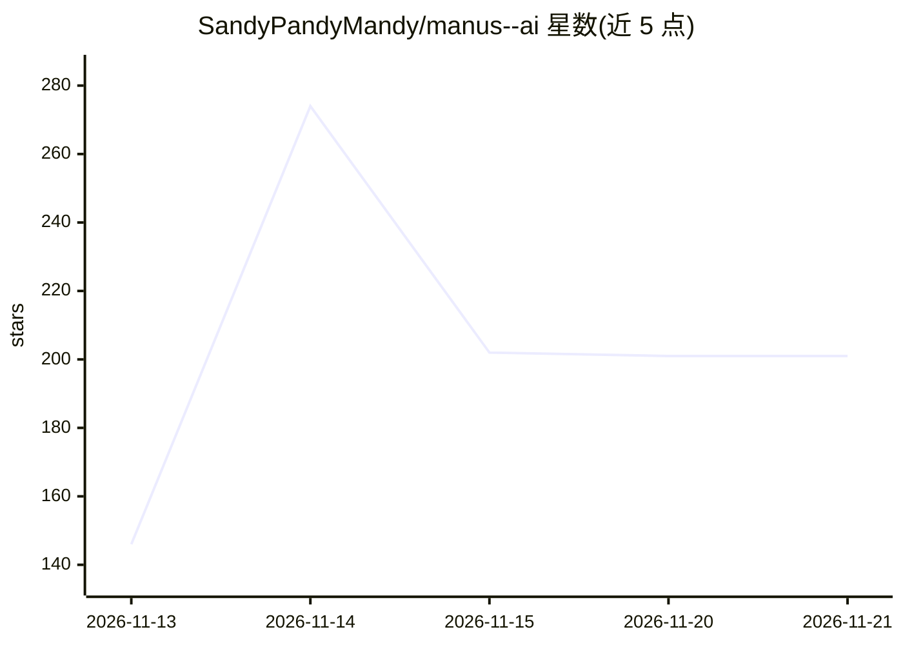

# SandyPandyMandy/manus--ai

⭐ 201 · Apache-2.0 · 推送 2026-11-19 · [GitHub](https://github.com/SandyPandyMandy/manus--ai) · 个人维护

**面向个人用户的自主 AI Agent，代用户执行代码与浏览器操作**

一个通用自主 AI Agent 系统，能力覆盖自动运行代码、控制浏览器（导航网页、填写表单、采集信息）、多步骤任务执行与后台个人助理。README 定位为面向家庭、学习与轻量办公场景的小型任务帮手，强调会话间一致性与低技术门槛，非企业级平台。提供下载入口（附促销码），给出 CPU/内存/存储/权限的最低与推荐配置表，无命令行安装步骤。

## 筛选速览

| 维度 | 判定 | 备注 |
|---|---|---|
| AI 角色 | `ai-native` | 本体是模型或模型工具 |
| 许可风险 | `permissive` | Apache-2.0 |
| 部署形态 | `None` |  |
| 模型依赖 | — | README 未给出锁定关系 |
| 硬件要求 | — | 无带数字的原话,不猜 |
| 安装摩擦 | `low` | 无编译、无系统依赖或容器化 |
| 成熟度 | — | 结构信号不足 |

## 能力要点

- 自主代码执行：代用户编写并运行脚本完成多步骤任务
- 浏览器控制：导航网页、填表、跨页面采集信息
- 后台常驻个人助理与跨会话任务模式记忆
- 提供最低/推荐硬件与权限配置表

## 适用场景

- 学习与研究中收集资料、跑小脚本、整理笔记
- 远程办公时从多个网页采集数据并汇总
- 把重复的填表、查网页、整理文件等琐事交给代理

## 场景标签

`AI 助手` `浏览器自动化` · 领域:效率与自动化

## 证据(README 行号)

> L18: Manus is an autonomous AI agent designed to run code and control a browser on your behalf. Instead of acting like a
> L41: |**Memory (RAM)**|4 GB|8 GB or more for heavy Manus autonomous tasks|

## 星数曲线

2026-11-13 146 → 2026-11-21 201（+55）

---
*卡片 v1 · prompt 1.4 · 生成 2026-11-20 · 置信度 mid · 依据 README sha `148cfe63626f` · [字段定义](../../DATASET.md)*
