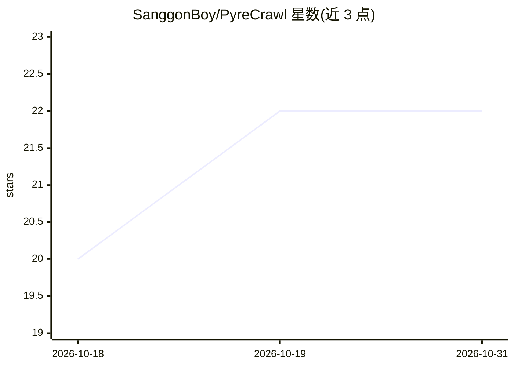

# SanggonBoy/PyreCrawl

⭐ 22 · Python · MIT · 推送 2026-09-21 · [GitHub](https://github.com/SanggonBoy/PyreCrawl) · [官网](https://pypi.org/project/pyrecrawl/) · 个人维护

**自托管的 MCP 服务器，让 AI agent 具备网页抓取/爬取/搜索/监控能力**

PyreCrawl 是一个自托管的 MCP（Model Context Protocol）服务器，通过 scrape、extract、crawl、map_site、search、deep_research、monitor 等工具为 Claude Desktop、Cursor、VS Code、Codex 等兼容 MCP 的 AI agent 提供网页操作能力。核心机制为三级自动回退（快速 HTTP → 隐身浏览器 → 深度处理），无需 API key；搜索走 DuckDuckGo HTML 与 arXiv/Crossref。支持 uvx/pipx/pip 安装，一次性安装 Chromium 引擎后由 pyrecrawl install 自动写入各 agent 的 MCP 配置。限制：含每 24 小时一次的匿名遥测 ping（可关闭）。

## 筛选速览

| 维度 | 判定 | 备注 |
|---|---|---|
| AI 角色 | `ai-ecosystem` | LLM/agent 周边工具 |
| 许可风险 | `permissive` | MIT |
| 部署形态 | `desktop` | 安装包/桌面程序 |
| 模型依赖 | — | README 未给出锁定关系 |
| 硬件要求 | — | 无带数字的原话,不猜 |
| 安装摩擦 | `low` | 无编译、无系统依赖或容器化 |
| 成熟度 | — | 结构信号不足 |

## 能力要点

- 三级自动回退：HTTP → 隐身浏览器（含 Cloudflare 绕过）→ 深度处理
- 13 个 MCP 工具：抓取、结构化抽取、爬取、站点地图、DuckDuckGo 搜索、arXiv/Crossref 学术搜索、变更监控、持久浏览器会话等
- 无需 API key，自托管；提供 pyrecrawl install 自动检测并写入 7 种 agent 的 MCP 配置
- 配套 Skills 仓库提供研究协议（anti-hallucination 规则），可复制为 CLAUDE.md/.cursorrules

## 适用场景

- 让 Claude/Cursor/Codex 等我的 agent 直接抓取网页并转成 markdown
- 多页爬取文档站点做概览或 RAG 数据摄取
- 对页面做变更监控（如价格变化）并输出 diff
- 通过 deep_research 一次调用获得带引用编号的证据包

## 场景标签

`网页抓取` · 领域:效率与自动化

## 证据(README 行号)

> L14: PyreCrawl speaks **MCP** (Model Context Protocol), the standard tool interface for Claude,
> L30: |`scrape(url, prefer="auto")`|Single URL → LLM-ready markdown|
> L120: Supported agents: `claude-desktop`, `claude-code`, `cursor`, `vscode`, `codex`, `opencode`, `hermes`.

## 星数曲线

2026-10-18 20 → 2026-10-31 22（+2）

---
*卡片 v1 · prompt 1.4 · 生成 2026-10-27 · 置信度 high · 依据 README sha `0d1faad74582` · [字段定义](../../DATASET.md)*
