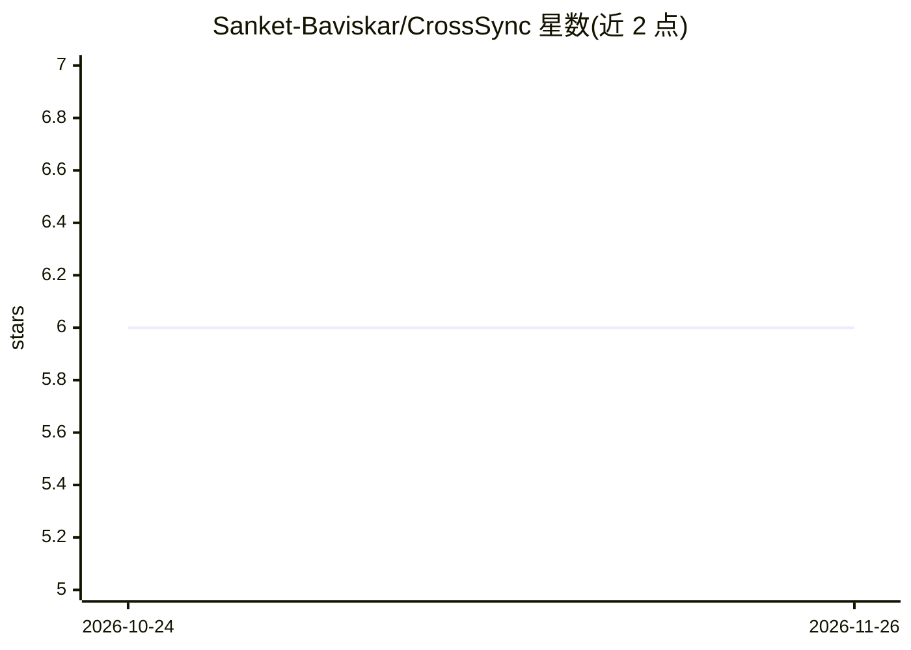

# Sanket-Baviskar/CrossSync

⭐ 6 · Kotlin · GPL-3.0 · 推送 2026-10-16 · [GitHub](https://github.com/Sanket-Baviskar/CrossSync) · [官网](https://github.com/Sanket-Baviskar/CrossSync/releases/latest) · 个人维护

**Windows 与 Android 间局域网剪贴板与文件同步工具**

跨 Windows 与 Android 的局域网同步工具：文本与图片双向剪贴板同步（单次上限 16 MB），文件经资源管理器右键菜单或系统分享面板发送，支持多台手机接入同一 PC 并经 PC 中继互传。传输走 TLS over TCP，配 6 位配对码与证书指纹固定；所有流量仅限局域网，无服务器、遥测或账号。Android 10+ 后台读剪贴板依赖无障碍服务监听复制信号；Windows 端 exe 尚未做 Authenticode 代码签名。

## 筛选速览

| 维度 | 判定 | 备注 |
|---|---|---|
| AI 角色 | `ai-enhanced` | 去掉 AI 部分产品仍成立 |
| 许可风险 | `viral` | GPL-3.0 |
| 部署形态 | `desktop` | 安装包/桌面程序 |
| 模型依赖 | — | README 未给出锁定关系 |
| 硬件要求 | — | 无带数字的原话,不猜 |
| 安装摩擦 | `medium` | 含编译或系统依赖之一 |
| 成熟度 | — | 结构信号不足 |

## 能力要点

- 文本与图片双向剪贴板同步，单次复制上限 16 MB
- TLS over TCP 传输，配 6 位配对码与证书指纹固定
- 多台手机接入同一 PC，文件经 PC 中继手机间互传
- 接收文件以 SHA-256 校验，传输可双向取消

## 适用场景

- 在同一 Wi-Fi 下手机复制内容直接粘贴到电脑
- 不经云服务在手机与电脑之间传文件
- 一台电脑同时连接多台手机共享剪贴板

## 场景标签

 · 领域:跨设备工具/剪贴板与文件同步

## 证据(README 行号)

> L5: **Clipboard and file sync between Windows and Android over your local Wi-Fi.** No cloud, no account, no internet nee
> L11: |**Windows app**|WPF · .NET 9 · CommunityToolkit.Mvvm|
> L12: |**Android app**|Kotlin · Jetpack Compose · Hilt · Room · WorkManager · Android 8.0+|

## 星数曲线

2026-10-24 6 → 2026-11-26 6（+0）

---
*卡片 v1 · prompt 1.4 · 生成 2026-11-20 · 置信度 high · 依据 README sha `88b5833e049d` · [字段定义](../../DATASET.md)*
