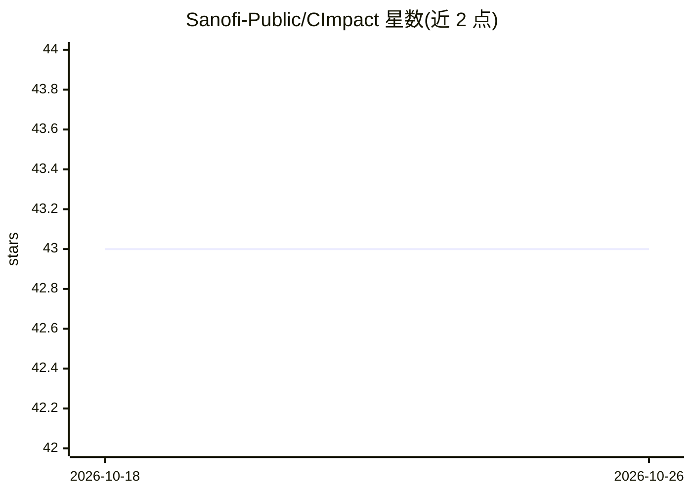

# Sanofi-Public/CImpact

⭐ 43 · Python · NOASSERTION · 推送 2026-10-20 · [GitHub](https://github.com/Sanofi-Public/CImpact) · [官网](https://pypi.org/project/cimpact/) · 组织维护

**时间序列因果效应估计库：多模型量化干预影响**

Sanofi 开源的 Python 因果推断库，用于估计干预对时间序列的因果效应。支持三种建模后端：TensorFlow Probability 的贝叶斯结构时间序列（BSTS）、Prophet 预测、Pyro 贝叶斯回归（VI/HMC），采用适配器式模块设计可扩展自定义模型。提供置信区间、前后干预期分析、残差诊断与可视化，可纳入协变量。扩展自 tfcausalimpact，面向分析师与数据科学家，通过 pip 安装。

## 筛选速览

| 维度 | 判定 | 备注 |
|---|---|---|
| AI 角色 | `ai-native` | 本体是模型或模型工具 |
| 许可风险 | `none` | NOASSERTION |
| 部署形态 | `library` | 以包/库形式分发 |
| 模型依赖 | — | README 未给出锁定关系 |
| 硬件要求 | — | 无带数字的原话,不猜 |
| 安装摩擦 | `low` | 无编译、无系统依赖或容器化 |
| 成熟度 | — | 结构信号不足 |

## 能力要点

- 三种模型后端：TensorFlow BSTS / Prophet / Pyro（VI/HMC）
- 输出点估计、置信区间与因果效应后验概率
- 适配器架构支持接入自定义模型
- 提供模型诊断（残差分析）与影响可视化

## 适用场景

- 评估营销活动对销量的因果影响
- 衡量新药或治疗对患者结局的效果
- 分析经济政策变化对关键指标的影响

## 场景标签

 · 领域:统计分析/因果推断

## 证据(README 行号)

> L9: CImpact is a modular causal impact analysis library for Python, supporting multiple time series models, including Te
> L17: CImpact is a versatile Python library designed to empower analysts and data scientists to evaluate the causal impac

## 星数曲线

2026-10-18 43 → 2026-10-26 43（+0）

---
*卡片 v1 · prompt 1.4 · 生成 2026-10-25 · 置信度 high · 依据 README sha `8b258f8c26f4` · [字段定义](../../DATASET.md)*
