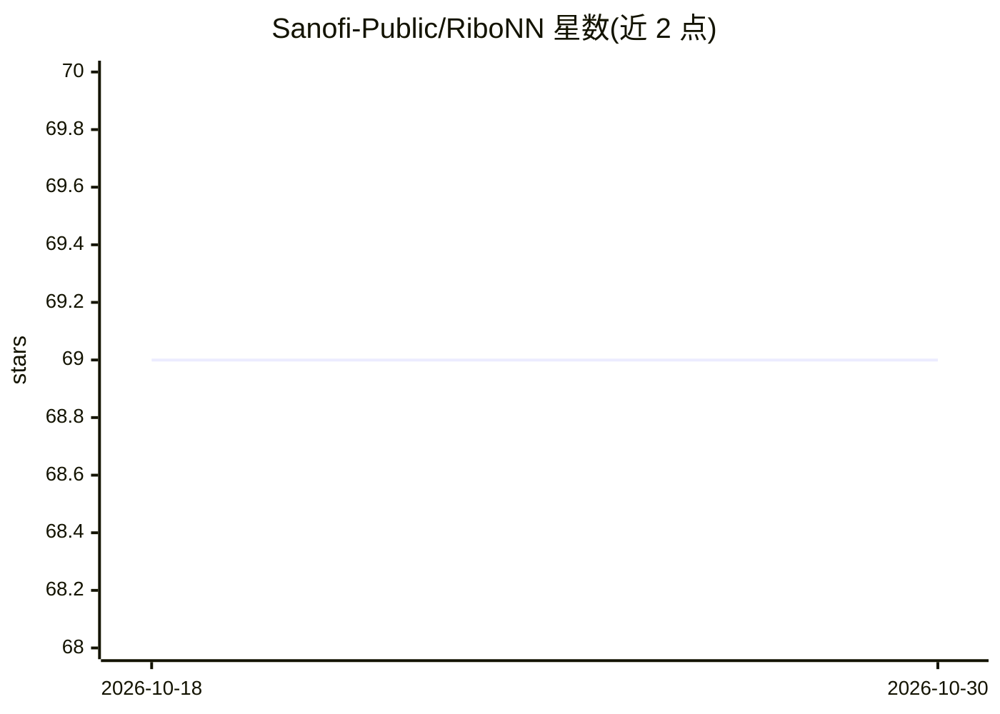

# Sanofi-Public/RiboNN

⭐ 69 · Python · NOASSERTION · 推送 2026-09-30 · [GitHub](https://github.com/Sanofi-Public/RiboNN) · 组织维护

**深度学习模型：从 mRNA 序列预测翻译效率**

Sanofi 公开的深度学习模型代码，读取 mRNA 序列（5'UTR/CDS/3'UTR 或全长转录本）预测翻译效率。支持从零训练、基于预训练人源多任务模型的迁移学习，以及直接下载预训练 human/mouse 模型做预测；预训练权重托管于 Zenodo。通过 mamba 环境与 Makefile 命令（make train / transfer_learning / predict_human / predict_mouse）运行，需 CUDA GPU；输入为制表符分隔文本，输出 prediction_output.txt。输入转录本 5'UTR 超过 1,381 nt 或 CDS+3'UTR 超过 11,937 nt 会被排除。

## 筛选速览

| 维度 | 判定 | 备注 |
|---|---|---|
| AI 角色 | `ai-native` | 本体是模型或模型工具 |
| 许可风险 | `none` | NOASSERTION |
| 部署形态 | `None` |  |
| 模型依赖 | — | README 未给出锁定关系 |
| 硬件要求 | — | 无带数字的原话,不猜 |
| 安装摩擦 | `medium` | 含编译或系统依赖之一 |
| 成熟度 | — | 结构信号不足 |

## 能力要点

- 从 mRNA 序列预测翻译效率的深度学习模型
- 提供 human/mouse 预训练模型（自动从 Zenodo 下载）
- 支持从零训练、迁移学习与预测三种流程
- 输入为制表符分隔的转录本序列文件

## 适用场景

- 预测目标 mRNA 序列的翻译效率
- 用自有数据对预训练模型做迁移学习
- 训练自定义的翻译效率预测模型

## 场景标签

`模型训练` · 领域:训练与推理

## 证据(README 行号)

> L1: # RiboNN: A deep learning model to predict translation efficiency from mRNA sequence
> L18: - To train the RiboNN model from scratch:

## 星数曲线

2026-10-18 69 → 2026-10-30 69（+0）

---
*卡片 v1 · prompt 1.4 · 生成 2026-10-24 · 置信度 high · 依据 README sha `9da885f8066b` · [字段定义](../../DATASET.md)*
