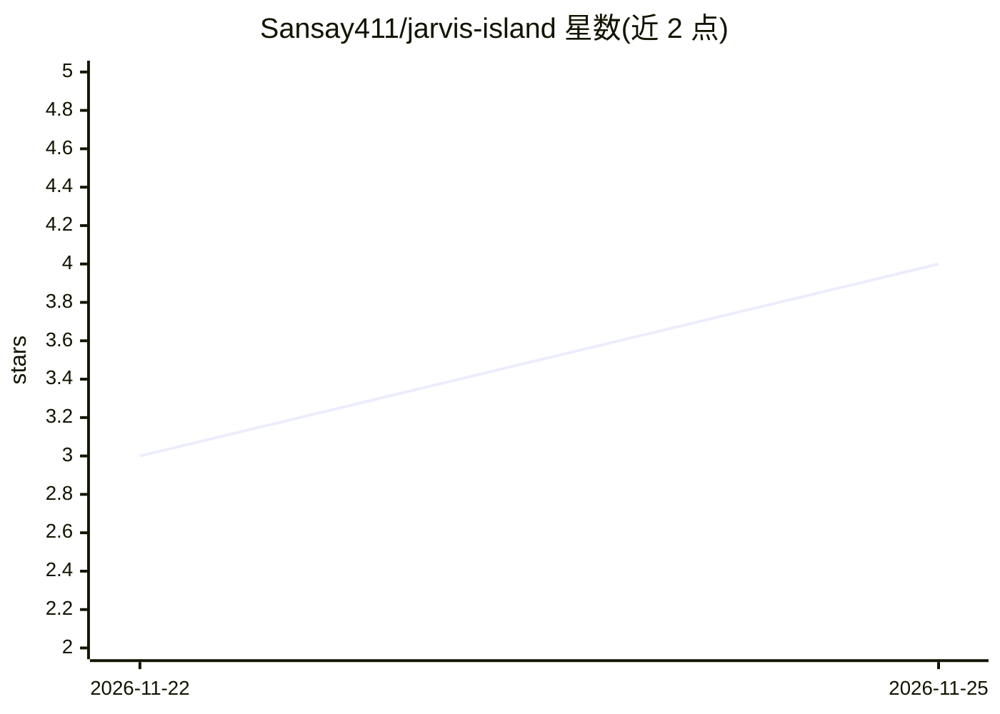

# Sansay411/jarvis-island

⭐ 4 · Rust · MIT · 推送 2026-11-23 · [GitHub](https://github.com/Sansay411/jarvis-island) · 个人维护

**Windows 灵动岛形态的语音 AI 代理，可代为操作电脑**

以屏幕顶部灵动岛形式驻留的 Windows 桌面应用：语音唤醒后可调节音量/亮度、启动程序、窗口布局、屏幕点击输入、读取浏览器标签页、转换文件、配音摘要等，动作执行后先核验结果再回复。本地识别语音，API 密钥存于 Windows 凭据管理器；默认接入 DeepSeek，亦支持其他 OpenAI 兼容接口与本地 Ollama。提供安装包与便携版，危险操作需确认并记录审计日志；语音识别目前仅支持俄语。

## 筛选速览

| 维度 | 判定 | 备注 |
|---|---|---|
| AI 角色 | `ai-native` | 本体是模型或模型工具 |
| 许可风险 | `permissive` | MIT |
| 部署形态 | `desktop` | 安装包/桌面程序 |
| 模型依赖 | local-ok | 支持本地模型 |
| 硬件要求 | — | 无带数字的原话,不猜 |
| 安装摩擦 | `medium` | 含编译或系统依赖之一 |
| 成熟度 | — | 结构信号不足 |

## 能力要点

- 语音指令代理操作：系统控制、窗口布局、屏幕点击与键盘输入（UI Automation）
- 支持 MCP 服务器接入，可整体粘贴 Claude Desktop/Cursor/VS Code 配置
- 本地语音识别（GigaAM v3）与离线语音回退（Supertonic 3/Piper），密钥存于 Windows 凭据管理器
- 危险操作（删除/发送/购买）强制确认，全部风险动作写入 audit_log

## 适用场景

- 动口不动手地调节音量、启动程序、整理窗口
- 拖入文件让代理提议并执行格式转换或音视频提取
- 让代理读取浏览器标签页并搜索、总结网页
- 离线场景下用本地语音与本地模型完成基本操作

## 场景标签

`语音 Agent` `GUI 自动化` · 领域:效率与自动化

## 证据(README 行号)

> L6: Говорите с ним голосом, и он делает дело на вашем компьютере.
> L22: Это не болталка. Джарвис меняет громкость и яркость, запускает программы, раскладывает окна по сетке, ведёт пошагов
> L50: |🖱️ **Управление экраном**|Снимок экрана или окна, клики, ввод текста, сочетания клавиш, прокрутка, кнопки и поля ч

## 星数曲线

2026-11-22 3 → 2026-11-25 4（+1）

---
*卡片 v1 · prompt 1.4 · 生成 2026-11-22 · 置信度 high · 依据 README sha `d91edfda023e` · [字段定义](../../DATASET.md)*
