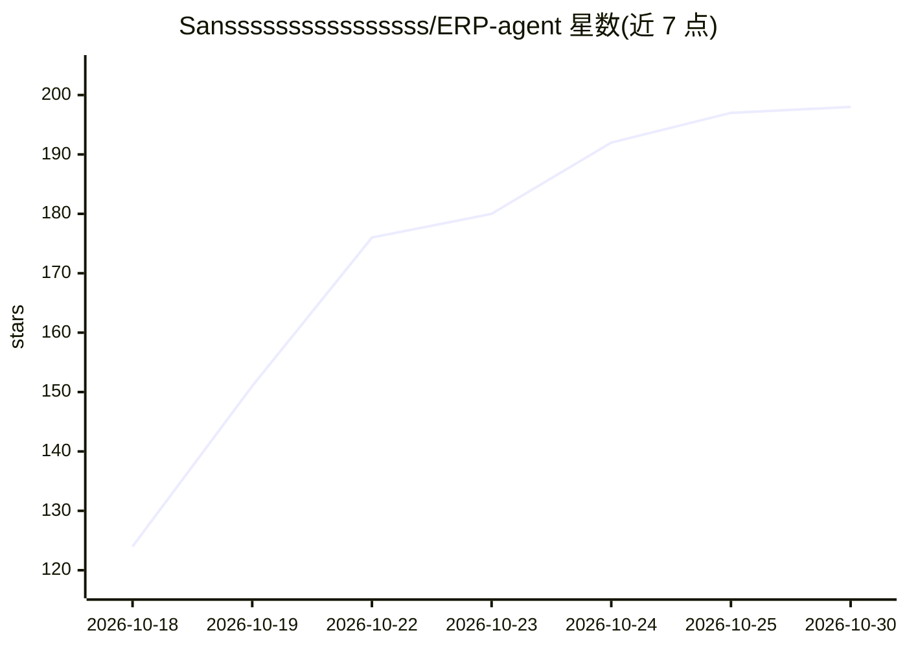

# Sanssssssssssssssss/ERP-agent

⭐ 198 · Python · MIT · 推送 2026-10-03 · [GitHub](https://github.com/Sanssssssssssssssss/ERP-agent) · 个人维护 · 中文 README

**让 AI Agent 实际操作 Odoo 19 ERP 的 Windows 桌面工作台**

面向 Odoo 19 的 AI agent 操作环境：用户以业务目标驱动，agent 读取单据、请求审批、执行确认的动作并读回结果。桌面端为 Electron 应用（React UI），运行原生 Python Harness（动态工具、受控业务流程、记录世界状态），覆盖销售、采购、库存、制造、开票、付款等流程。附带 ERP-Bench/Harbor 评测路径。需自备 Odoo 19 JSON-2 连接与模型端点；源码运行需 Node.js 22+、Python 3.13 与 uv，另有 Windows v0.6.0 预览版（含旧 UI）。

## 筛选速览

| 维度 | 判定 | 备注 |
|---|---|---|
| AI 角色 | `ai-native` | 本体是模型或模型工具 |
| 许可风险 | `permissive` | MIT |
| 部署形态 | `library` | 以包/库形式分发 |
| 模型依赖 | — | README 未给出锁定关系 |
| 硬件要求 | — | 无带数字的原话,不猜 |
| 安装摩擦 | `low` | 无编译、无系统依赖或容器化 |
| 成熟度 | `idea` | |

## 能力要点

- 审批式业务动作执行：变更前展示受影响记录与拟议值
- 执行追踪（Trace）：工具名、参数、风险、结果与原始凭据
- 业务状态、审批与动作凭据跨中断持久化
- ERP-Bench/Harbor 固定任务评测路径与本地知识检索（BM25）

## 适用场景

- 让 agent 按业务目标在 Odoo 中执行并核验销售/采购/库存等操作
- 以人工审批方式控制 agent 对 ERP 的写操作
- 运行 ERP-Bench 任务评测 agent 的 ERP 操作能力

## 场景标签

`模型评测` · 领域:评测与运维

## 证据(README 行号)

> L3:  An AI Agent that can actually operate your ERP.
> L67: The desktop runs the native Python Harness with dynamic tools, controlled business procedures and recorded world st

## 星数曲线

2026-10-18 124 → 2026-10-30 198（+74）

---
*卡片 v1 · prompt 1.4 · 生成 2026-10-22 · 置信度 mid · 依据 README sha `d5602bca2d71` · [字段定义](../../DATASET.md)*
